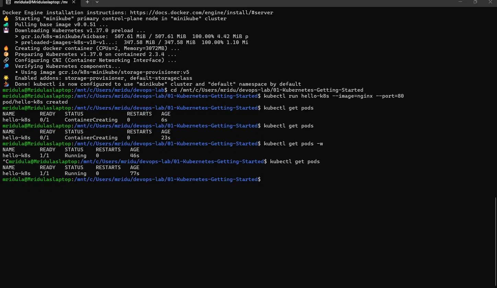
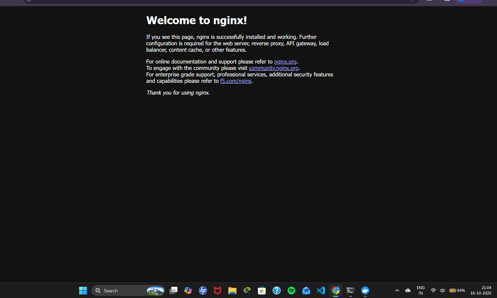

# Exercise 1: Kubernetes Getting Started (Hello Pod)

## Objective
Deploy a web app (Nginx, simulating Zepto's storefront) as a Pod on a local Kubernetes cluster using Minikube, and access it from the browser.

## Environment
- Windows 11 + WSL2 (Ubuntu)
- Docker Desktop (WSL integration enabled)
- Minikube (docker driver) + kubectl

## Steps and Commands

### 1. Start the Kubernetes cluster
```bash
minikube start --driver=docker
```

### 2. Create a Pod using the Nginx image
```bash
kubectl run hello-k8s --image=nginx --port=80
```

### 3. Verify the Pod is running
```bash
kubectl get pods
```

### 4. Expose the Pod as a NodePort Service
```bash
kubectl expose pod hello-k8s --type=NodePort --port=80
```

### 5. Access the app in the browser
```bash
minikube service hello-k8s --url
```
Open the printed URL in a browser to see the Nginx welcome page.

## Output Screenshots

### Pod running


### Nginx welcome page in browser


## Learnings
- A **Pod** is the smallest deployable unit in Kubernetes; it wraps one or more containers.
- `kubectl run` creates a Pod directly from a container image.
- A **Service** of type **NodePort** exposes the Pod outside the cluster.
- `minikube service --url` gives a reachable URL for the Service on the local machine.
