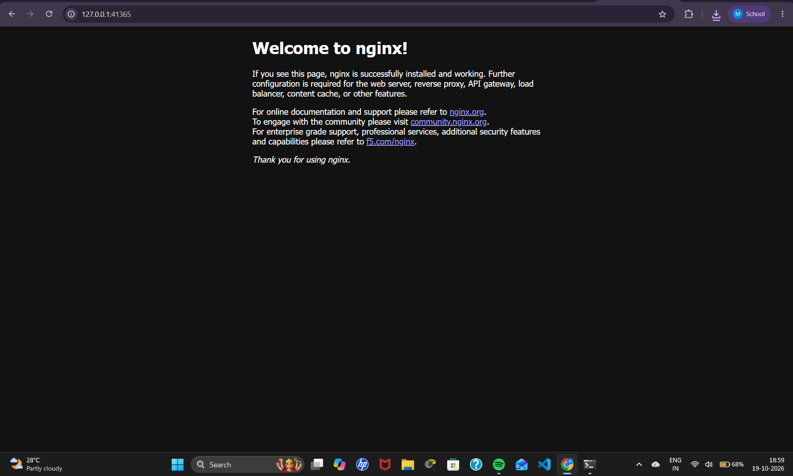

# Exercise 1: Kubernetes Getting Started (Hello Pod)

## Objective
Deploy a web app (Nginx, simulating Zepto's storefront) as a Pod on a local Kubernetes cluster using Minikube, and access it from the browser.

## Environment
- Windows 11 + WSL2 (Ubuntu)
- Docker Desktop (WSL integration enabled)
- Minikube (docker driver) + kubectl

## Steps and Commands

### 1. Start the Kubernetes cluster
```bash
minikube start
```

### 2. Create a Pod using the Nginx image
```bash
kubectl run hello-k8s --image=nginx --port=80
```

### 3. Verify the Pod is running
```bash
kubectl get pods
```

### 4. Expose the Pod as a NodePort Service
```bash
kubectl expose pod hello-k8s --type=NodePort --port=80
```

### 5. Access the app in the browser
```bash
minikube service hello-k8s
```
Minikube prints the service URL and starts a tunnel (`http://127.0.0.1:<port>`). With the Docker driver on WSL the terminal must stay open while the tunnel runs. Opening that URL shows the Nginx welcome page.

## Output Screenshots

### Pod running and exposed as a NodePort Service


### minikube service hello-k8s


### Nginx welcome page in browser


## Learnings
- A **Pod** is the smallest deployable unit in Kubernetes; it wraps one or more containers.
- `kubectl run` creates a Pod directly from a container image.
- A **Service** of type **NodePort** exposes the Pod outside the cluster.
- `minikube service <name>` gives a reachable URL for the Service on the local machine (through a tunnel on the Docker driver).

## System Internal Details
What happens inside Kubernetes when `kubectl run hello-k8s --image=nginx --port=80` runs (from the manual's diagram):

1. **kubectl → kube-apiserver:** kubectl sends a Pod manifest (Pod name `hello-k8s`, image `nginx`, port `80`) to the API server through its REST API. In effect: "please create this Pod for me".
2. **kube-apiserver → etcd:** the API server receives the request and stores the Pod manifest in etcd: "there should be a Pod called `hello-k8s` running an nginx container on port 80".
3. **kube-scheduler:** watches the desired state in etcd and chooses a worker node that has enough CPU and memory.
4. **Scheduler → kubelet:** the kubelet is the agent on each worker node. It is told: "you run this Pod on your system".
5. **kubelet → container runtime (CRI-O in the diagram):** pulls the nginx image from Docker Hub (or another registry), creates a container from the image, sets up the filesystem and mounts volumes, then runs the process in an isolated Linux namespace (PID, network, cgroup). Minikube uses its own runtime (containerd by default) instead of CRI-O.
6. **CNI (Container Network Interface):** assigns a unique IP address to the Pod, reachable inside the cluster.
7. **kubelet → kube-apiserver:** the kubelet reports back "Pod `hello-k8s` is running", which is the status shown by `kubectl get pods`.

Other components in the diagram: the control plane also has **kube-controller-manager** and **cloud-controller-manager**, and each worker node has **kube-proxy**.
