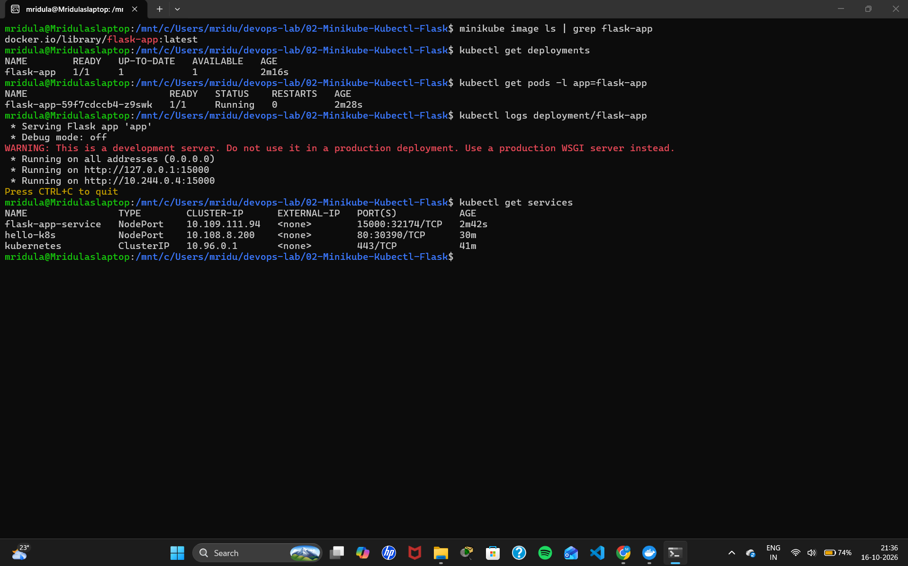
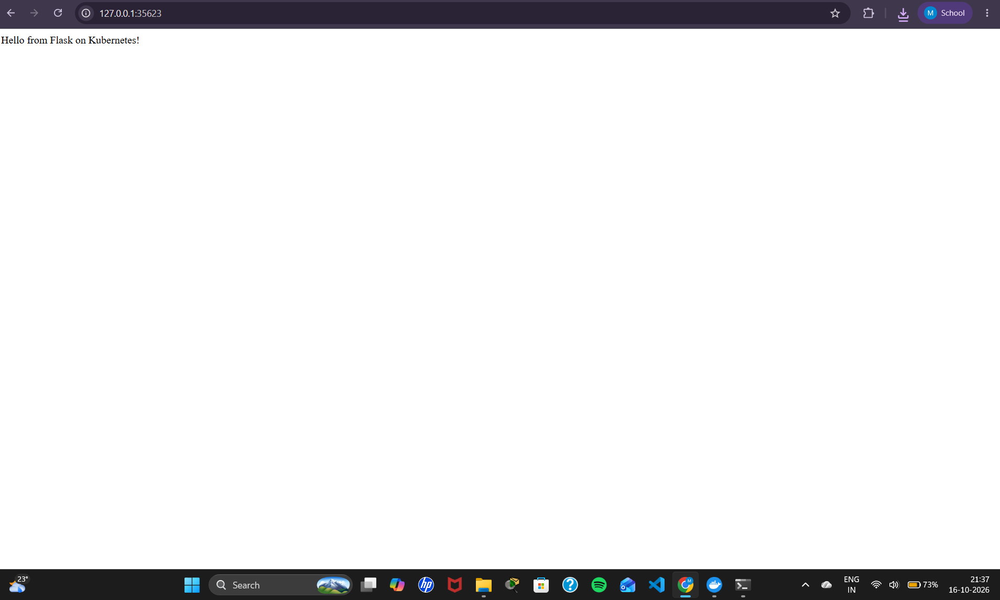

# Exercise 2: Deploy a Flask App on Minikube using kubectl and YAML

## Objective
Build a Python Flask application into a Docker image, deploy it on a single-node Minikube cluster using a Kubernetes Deployment YAML, and expose it using a NodePort Service.

## Files
| File | Purpose |
|------|---------|
| `app.py` | Flask app that returns "Hello from Flask on Kubernetes!" on port 15000 |
| `Dockerfile` | Builds the Flask app into a Docker image |
| `flask-deployment.yaml` | Kubernetes Deployment (1 replica) + NodePort Service on port 15000 |

## Steps and Commands

### 1. Start Minikube
```bash
minikube start --driver=docker
```

### 2. Build the Docker image inside Minikube
```bash
minikube image build -t flask-app:latest .
```
> Note: Minikube here uses the containerd runtime, so `minikube image build` is used instead of `eval $(minikube docker-env)` + `docker build`. The result is the same: the image is available inside the cluster.

### 3. Deploy the app
```bash
kubectl apply -f flask-deployment.yaml
```

### 4. Verify the deployment, pods, logs and service
```bash
kubectl get deployments
kubectl get pods -l app=flask-app
kubectl logs deployment/flask-app
kubectl get services
```

### 5. Access the app
```bash
minikube service flask-app-service --url
```
Open the printed URL in a browser.

## Output Screenshots

### Image, Deployment, Pod, Logs and Service


### Flask app running in browser


## Learnings
- `imagePullPolicy: Never` makes Kubernetes use the locally built image instead of pulling from Docker Hub.
- **port** is the port exposed by the Service; **targetPort** is the port the container listens on.
- Flow: Browser → Service (15000) → Container (15000) → Flask app.
- `minikube service <name> --url` gives a reachable URL because Minikube runs inside Docker and is not directly reachable otherwise.
