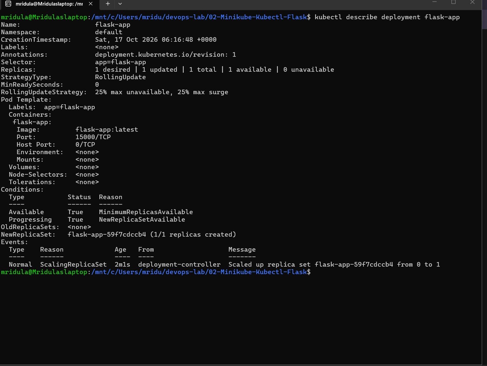
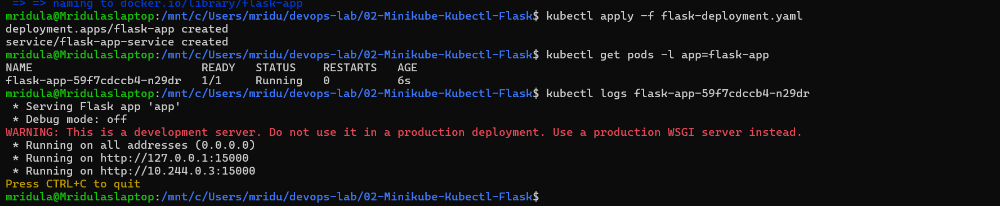
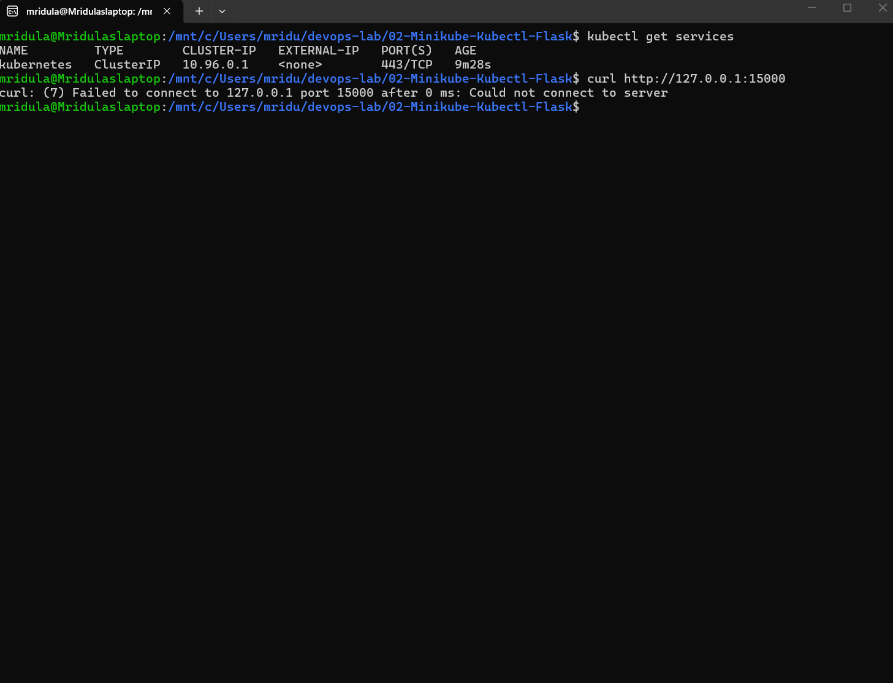
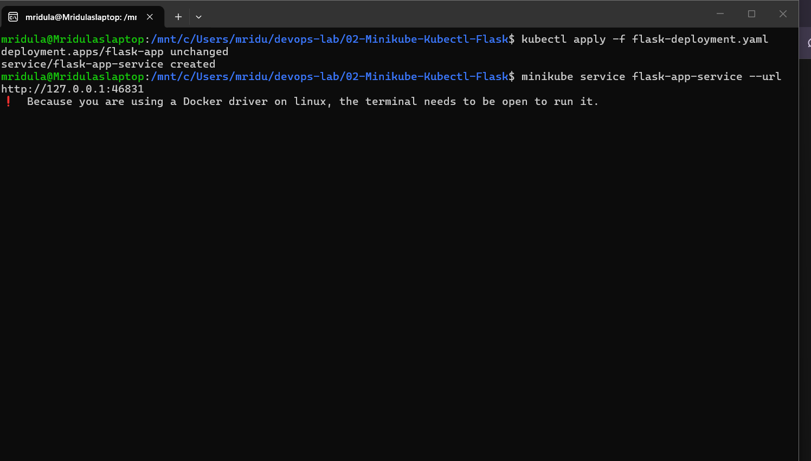
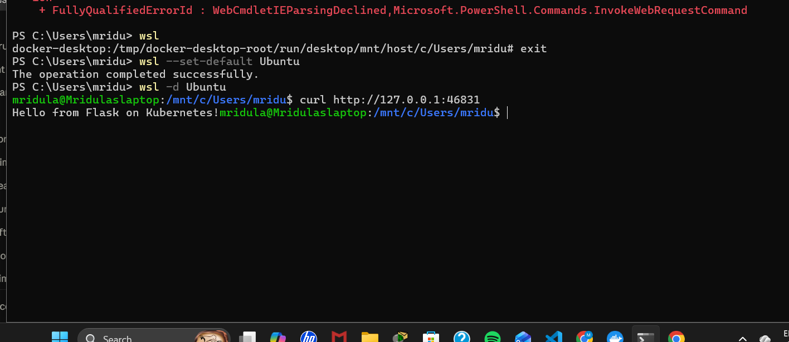

# Exercise 2: Deploy a Flask App on Minikube using kubectl and YAML

## Objective
Learn Kubernetes basics using Minikube: set up a single-node cluster and deploy a Python Flask application using kubectl and a YAML file.

## Files
| File | Purpose |
|------|---------|
| `app.py` | Flask app that returns "Hello from Flask on Kubernetes!" on port 15000 |
| `Dockerfile` | Builds the Flask app image |
| `flask-deployment.yaml` | Deployment (1 replica, `imagePullPolicy: Never`) + NodePort Service (port 15000 → targetPort 15000) |

## Steps

### Step 1: Start Minikube
~~~bash
minikube start --driver=docker --container-runtime=docker
~~~

### Steps 2-3: Create app.py and Dockerfile

### Step 4: Build the image with Minikube's Docker daemon
~~~bash
minikube docker-env
eval $(minikube docker-env)
docker build -t flask-app .
docker images | grep flask-app
~~~

### Steps 5-8: Create the Deployment (without Service), apply and verify
~~~bash
kubectl apply -f flask-deployment.yaml
kubectl get deployments
kubectl get pods -l app=flask-app
~~~

### Step 9: Describe the deployment
~~~bash
kubectl describe deployment flask-app
~~~

### Step 10: View the logs
~~~bash
kubectl get pods -l app=flask-app       # copy the pod name
kubectl logs <pod-name>                 # e.g. kubectl logs flask-app-59f7cdccb4-n29dr
~~~

### Steps 11-12: Check services and try to access the app
~~~bash
kubectl get services
curl http://127.0.0.1:15000
~~~
curl fails because Minikube runs in a separate environment: the app's port 15000 is exposed inside the cluster but not outside.

### Step 13: Add a Service section to the YAML and access the app
~~~bash
kubectl apply -f flask-deployment.yaml      # deployment unchanged, service created
minikube service flask-app-service --url    # keep this terminal open
curl http://127.0.0.1:<port>                # in a new terminal
~~~
Flow: External request → Service (port 15000) → Container (targetPort 15000) → Flask app.

## Output Screenshots

### Step 4: minikube docker-env and docker build

### Steps 6-8: Deployment and Pod running

### Step 9: Describe deployment

### Step 10: Logs

### Steps 11-12: Only kubernetes service, curl fails

### Step 13: Service created and URL

### Step 13: curl succeeds

## Q&A
1. **Purpose of `minikube service flask-app-service --url`?** To provide the URL for accessing the service running in Minikube.
2. **What happens when you run it?** Minikube checks the service is running, generates a URL and displays it.
3. **Why is targetPort used?** To specify the port the container is listening on.
4. **port vs targetPort?** `port` is the exposed Service port; `targetPort` is the container port.
5. **How do you access a Flask app in Minikube?** `minikube service <service-name> --url`.
6. **Why must the terminal stay open with the Docker driver?** The Docker driver needs the terminal open to keep the tunnel to Minikube running.
7. **Benefit of `--url`?** It gives the access URL without building it manually.
8. **Command to expose a service?** `kubectl expose` or `kubectl apply -f <service.yaml>`.
9. **How does Minikube help?** It runs a single-node Kubernetes cluster locally for testing.
10. **Role of kubectl?** The Kubernetes CLI used to deploy, scale and manage resources in the cluster.
