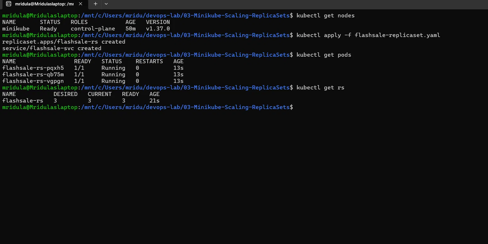
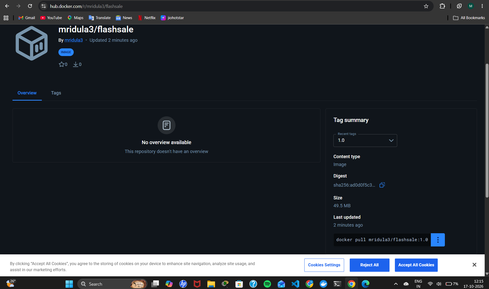
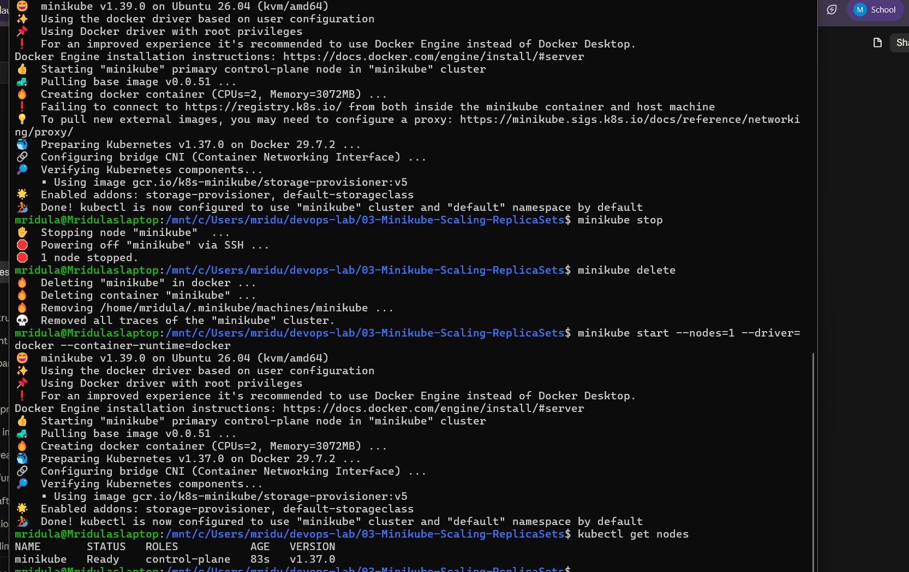
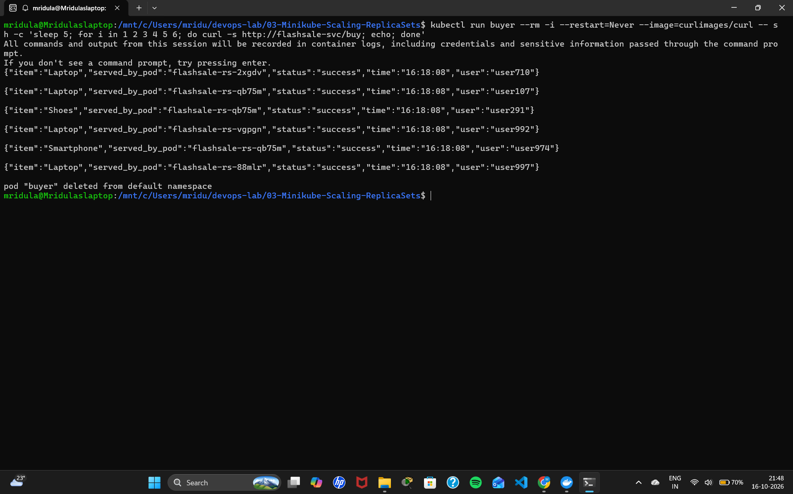
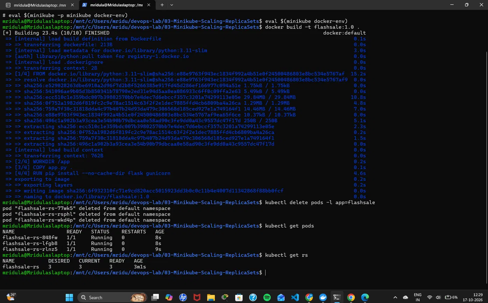
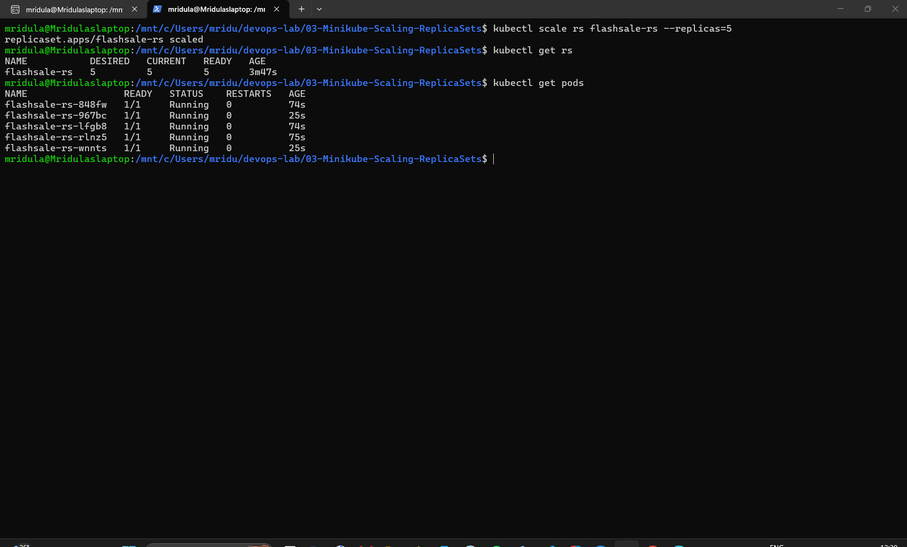
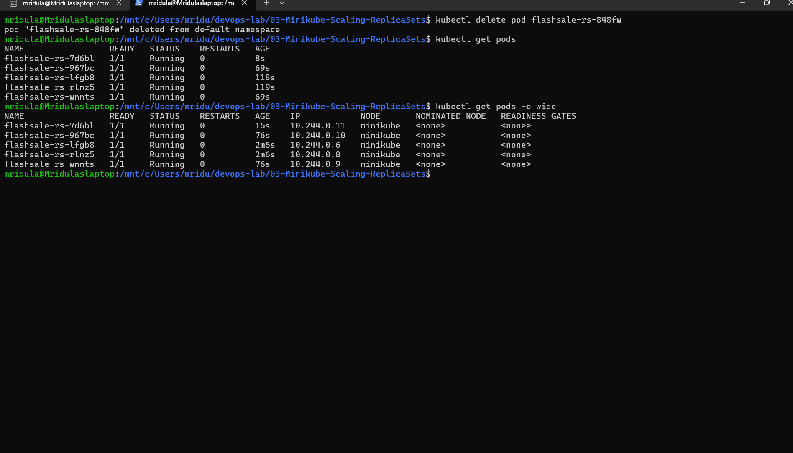

# Exercise 3: Scaling a Flask App on a Single Node using ReplicaSets

## Use Case: E-commerce Flash Sale
During a flash sale (like Big Billion Days or Prime Day), traffic jumps from 100 to 10,000 requests per minute. A single Pod would crash. A **ReplicaSet** runs many identical Pods of the app and spreads requests across them, and scales back down after the sale.

## Objective
- Understand ReplicaSets and Pods
- Scale the Flask app
- Observe Pod distribution and self-healing

## Environment
Windows 11 + WSL2 (Ubuntu) + Docker Desktop; Minikube (Docker driver, started with `--container-runtime=docker`) and kubectl.

## Files
| File | Purpose |
|------|---------|
| `app.py` | Flash sale app: `/` (welcome), `/buy` (checkout, shows serving Pod), `/health` (probes) |
| `Dockerfile` | python:3.11-slim + flask + gunicorn on port 5000 |
| `flashsale-replicaset.yaml` | ReplicaSet (3 replicas, readiness/liveness probes, resource limits) + ClusterIP Service |

## Steps

### Build and push the image to Docker Hub
~~~bash
docker build -t mridula3/flashsale:1.0 .
docker push mridula3/flashsale:1.0
~~~
Image: https://hub.docker.com/r/mridula3/flashsale

### Step 1: Clean up previous Minikube
~~~bash
minikube stop
minikube delete
~~~

### Step 2: Start Minikube with a single node
~~~bash
minikube start --nodes=1 --driver=docker --container-runtime=docker
kubectl get nodes
~~~

### Steps 3-4: Create and apply the ReplicaSet
~~~bash
kubectl apply -f flashsale-replicaset.yaml
kubectl get pods
~~~
The Pods show `ErrImagePull` at first because the image is only built in Step 5.

### Step 5: Build the image inside Minikube
~~~bash
minikube docker-env
eval $(minikube docker-env)
docker build -t flashsale:1.0 .
kubectl delete pods -l app=flashsale     # restart the failed Pods so they use the new image
~~~

### Step 6: Verify the Pods and ReplicaSet
~~~bash
kubectl get pods
kubectl get rs
~~~

### Steps 7-9: Scale to 5 replicas
~~~bash
kubectl scale rs flashsale-rs --replicas=5
kubectl get rs
kubectl get pods
~~~

### Steps 10-11: Delete a Pod and observe self-healing
~~~bash
kubectl delete pod <pod-name>
kubectl get pods
kubectl get pods -o wide
~~~

## Notes on the Lab Manual
- The manual's Dockerfile copies `ex3-flash-sale.py` but runs `app:app`; the file is named `app.py` here so gunicorn can find it.
- The manual's Step 5 builds `flask-app`, but the YAML uses `flashsale:1.0`; the image is tagged `flashsale:1.0` so the Pods can find it.
- The manual's scale/delete commands say `flask-app-rs`, but the YAML names the ReplicaSet `flashsale-rs`.
- Minikube is started with `--container-runtime=docker` so `eval $(minikube docker-env)` works.

## Output Screenshots

### Image built and pushed to Docker Hub

### Image on Docker Hub

### Steps 1-2: Minikube cleaned up and started with one node

### Steps 3-4: ReplicaSet applied (image not built yet)

### Steps 5-6: Image built in Minikube, 3 Pods running

### Steps 7-9: Scaled to 5 replicas

### Steps 10-11: Deleted Pod replaced automatically, all Pods on one node

## Q&A
1. **Initial number of replicas?** 3
2. **Pods running after applying the ReplicaSet?** 3
3. **What happens when scaled to 5?** Kubernetes creates 2 more Pods to reach 5.
4. **What happens when one Pod is deleted?** The ReplicaSet automatically creates a new Pod to keep 5 running.
5. **How does Kubernetes maintain replicas?** It continuously compares the actual Pod count with the desired count and creates or deletes Pods to match.
6. **How many nodes are running?** 1
7. **Where are the Pods running?** All 5 Pods run on the single node `minikube`.

## Key Learnings
- **Pod distribution:** each Pod is an identical worker; scaling creates clones of the app.
- **Resiliency:** if a Pod fails, the ReplicaSet creates another, so users don't notice downtime.
- **Efficiency:** add Pods when demand spikes and remove them when it drops.
- **Scalability in the real world:** this is how Netflix, YouTube or Swiggy scale their microservices to handle peak traffic hours.

## Additional Challenges and Tips (from the manual)
These are listed at the end of the manual's Exercise 3. They are not part of the numbered steps above.

**Additional challenges**
- Update `replicaset.yaml` to use a different image.
- Create a Deployment instead of a ReplicaSet.
- Use `kubectl describe` to inspect the ReplicaSet and Pods.

**Tips and variations**
- `kubectl get pods -o wide`: shows Pod distribution across nodes.
- `kubectl logs <pod-name>`: shows the logs of a Pod.
- `kubectl exec -it <pod-name> -- sh`: opens a shell in a Pod's container.

## Result
The ReplicaSet started 3 Pods once the image was built inside Minikube. Scaling to 5 replicas created 2 more Pods. When one Pod was deleted, the ReplicaSet created a replacement automatically, and all 5 Pods ran on the single node `minikube`.
