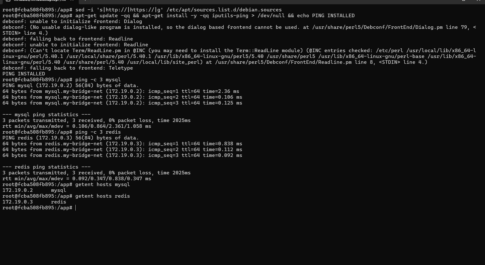
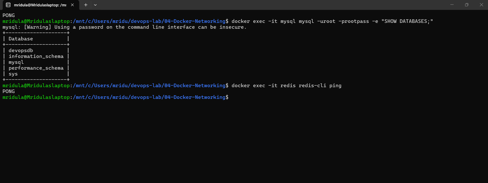
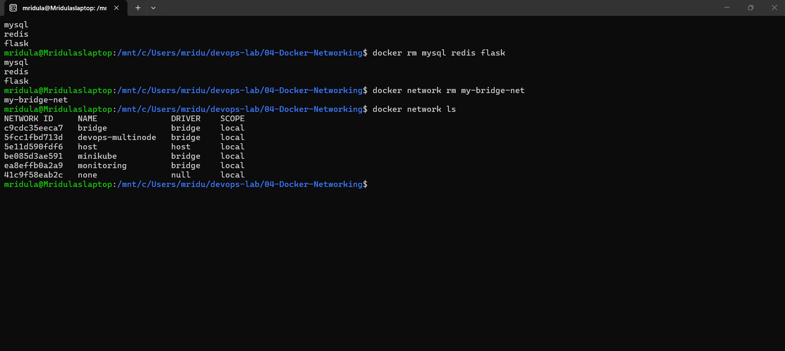

# Exercise 4: Docker Networking with Multiple Containers

## Objective
Build and verify a three-container application (Flask API, MySQL, Redis) on a user-defined Docker bridge network, understand host-to-container port publishing, and demonstrate container-to-container DNS / service discovery.

This exercise follows the lab manual page and its **detailed steps document** ("Docker Networking Lab – Complete Part 0–27", linked at the end of the manual page). The commands were run in WSL2 Ubuntu, so `curl` is used instead of `curl.exe` and `\` instead of the PowerShell backtick for line breaks.

## Architecture
```
Host (localhost:5001)
        |
        v
  Flask container (flask :5001)
        |
   my-bridge-net
     /        \
    v          v
 MySQL       Redis
 (mysql)     (redis)
```
Host → Flask uses the published port `-p 5001:5001`. Flask → MySQL and Flask → Redis use the internal Docker network and the container names. Ports 3306 and 6379 do not need to be published.

## Files
| File | Purpose |
|------|---------|
| `app.py` | Flask REST API with an `/about` endpoint, listening on `0.0.0.0:5001` |
| `requirements.txt` | `Flask==2.0.1` and `Werkzeug==2.0.3` |
| `Dockerfile` | Builds the Flask image (`python:3.9-slim`) |

## Steps and Commands

### Task 1 and Task 2 (Parts 1–3): Create the bridge network and verify it
```bash
docker --version
docker info
docker ps
docker network create --driver bridge my-bridge-net
docker network ls
```

### Task 3 (Part 4): Inspect the network
```bash
docker network inspect my-bridge-net
```

### Task 4 (Parts 5–7): Create app.py, requirements.txt and Dockerfile
`app.py` (Part 5): note `host='0.0.0.0'`, so Flask listens on all interfaces inside the container, not only on `127.0.0.1`.
```python
from flask import Flask, jsonify

app = Flask(__name__)

@app.route('/about', methods=['GET'])
def about():
    return jsonify({
        "name": "Simple REST API",
        "version": "1.0",
        "description": "This is a simple REST API built with Flask."
    })

if __name__ == '__main__':
    app.run(host='0.0.0.0', port=5001)
```
`requirements.txt` (Part 6): Werkzeug is pinned because Flask 2.0.1 fails with newer Werkzeug (`ImportError: cannot import name 'url_quote'`).
```
Flask==2.0.1
Werkzeug==2.0.3
```
`Dockerfile` (Part 7):
```dockerfile
# Use the official Python image from the Docker Hub
FROM python:3.9-slim

# Set the working directory in the container
WORKDIR /app

# Copy the requirements file and app code to the container
COPY requirements.txt .
COPY app.py .

# Install Flask (and any other dependencies you might have)
RUN pip install --no-cache-dir -r requirements.txt

# Expose the port the app runs on
EXPOSE 5001

# Define the command to run the application
CMD ["python", "app.py"]
```

### Task 4 (Part 8): Build the Flask image
```bash
docker build --no-cache -t flask-api .
docker images
```

### Task 4 (Part 9): Test the Flask image on its own
```bash
docker run -d --name flask-test -p 5001:5001 flask-api
docker ps
curl http://localhost:5001/about
```

### Task 4 (Parts 10–13): Launch MySQL, Redis and Flask on the same network
```bash
docker run -d --name mysql --network my-bridge-net \
  -e MYSQL_ROOT_PASSWORD=rootpass -e MYSQL_DATABASE=devopsdb mysql:latest
docker run -d --name redis --network my-bridge-net redis:latest
docker rm -f flask-test
docker run -d --name flask --network my-bridge-net -p 5001:5001 flask-api
docker ps
docker network inspect my-bridge-net     # mysql, redis and flask listed under "Containers"
```
Part 14: `-p HOST_PORT:CONTAINER_PORT`. `-p 5001:5001` maps host port 5001 to container port 5001. It is only needed for access from outside the Docker network.

### Task 5 (Part 15): Test connectivity, Flask API from the host
```bash
curl http://localhost:5001/about
docker port flask
```

### Task 5 (Parts 16–17): Enter the Flask container and test DNS
```bash
docker exec -it flask bash
```
Inside the container (`python:3.9-slim` has no `ping`, so it is installed first; apt sources are switched to https because plain http is blocked on this network):
```bash
sed -i 's|http://|https://|g' /etc/apt/sources.list.d/debian.sources
apt-get update && apt-get install -y iputils-ping
ping -c 3 mysql
ping -c 3 redis
getent hosts mysql
getent hosts redis
exit
```

### Task 5 (Parts 18–19): Test Redis and MySQL
```bash
docker exec -it redis redis-cli ping
docker exec -it mysql mysql -uroot -prootpass -e "SHOW DATABASES;"
```
Expected: `PONG`, and a database list including `devopsdb`.

### Task 5 (Part 21): Verify everything
```bash
docker ps
docker port flask
curl http://localhost:5001/about
docker exec flask getent hosts mysql
docker exec flask getent hosts redis
```

### Task 6 (Parts 25–26): Clean up
```bash
docker stop mysql redis flask
docker rm mysql redis flask
docker network rm my-bridge-net
docker network ls
```

## Notes
- The detailed lab document already includes the fixes needed to run this exercise: `host='0.0.0.0'` in `app.py`, `Werkzeug==2.0.3`, a MySQL root password, and installing `ping` inside the container. All of them were followed.
- Commands were run in WSL2 Ubuntu instead of PowerShell (`curl` instead of `curl.exe`, `\` instead of the backtick).

## Output Screenshots

### Part 1–3: Docker verified, network created and listed


### Part 4: Network inspected (subnet and gateway)


### Part 8: Flask image built


### Part 9: Flask image tested on its own


### Part 10–13: MySQL, Redis and Flask running on my-bridge-net


### Part 12: All three containers listed in the network


### Part 15: Flask API reachable from the host through the published port


### Part 16–17: DNS / service discovery from inside the Flask container


### Part 18–19: Redis PONG and MySQL databases


### Part 25–26: Cleanup


## Q&A
1. **Purpose of the `--net` flag?** It specifies the Docker network to connect the container to. The modern syntax is `--network`.
2. **How do containers communicate on the same network?** Using container names (Docker's built-in DNS) or IP addresses. Names are preferred because IPs can change when containers are recreated.
3. **Bridge vs host network?** A bridge network gives each container its own network namespace connected through Docker networking; a host network shares the host's network stack directly.
4. **How to expose a container port to the host?** Use `-p HOST_PORT:CONTAINER_PORT`, e.g. `-p 5001:5001`.

## Learnings
- A user-defined bridge network gives containers DNS-based service discovery by container name.
- A published port (`-p`) is the entry point from the host; containers on the same network talk directly without published ports.
- Inside a container, Flask must bind to `0.0.0.0` to be reachable through a published port.
- Pinning dependency versions (Flask + Werkzeug) keeps builds reproducible.
