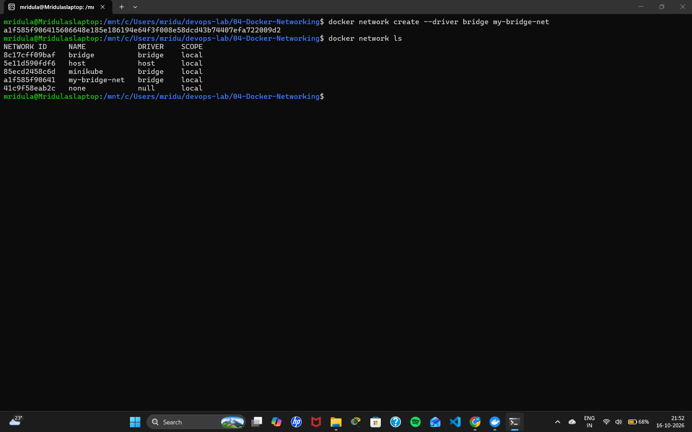
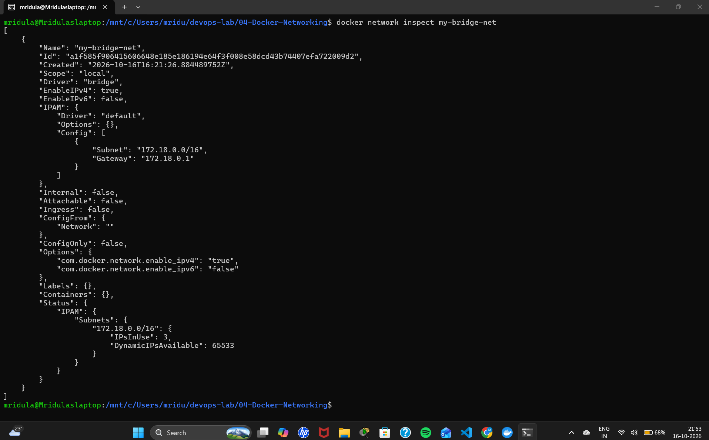
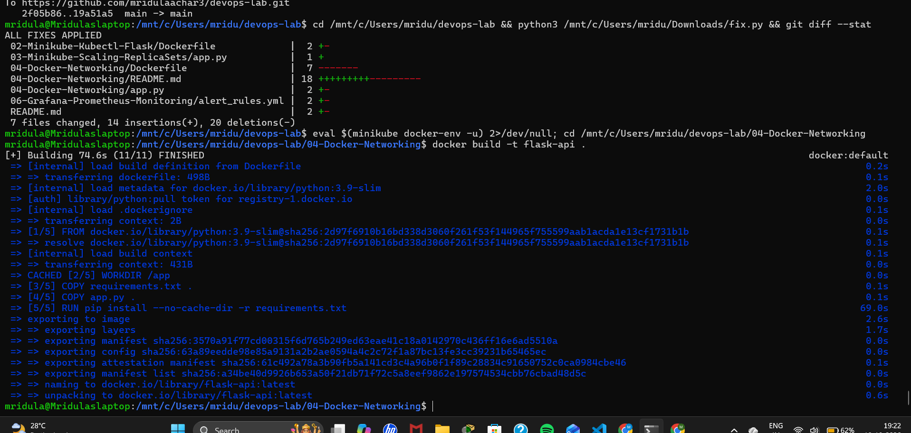
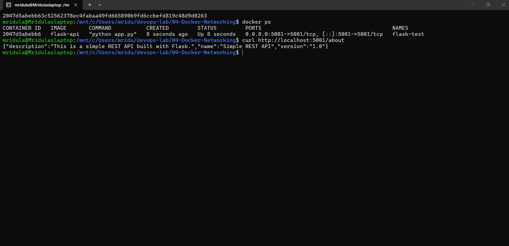
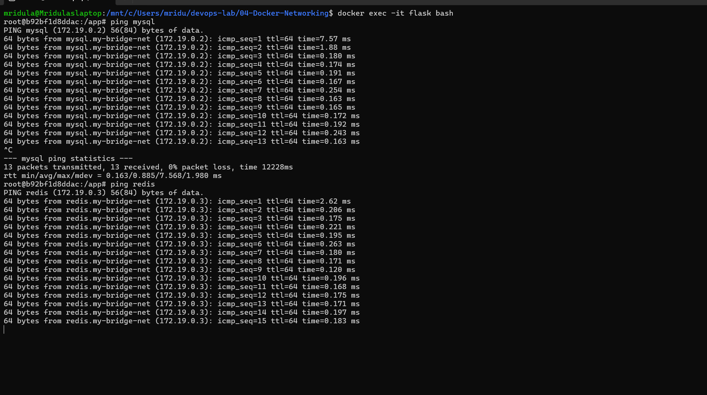
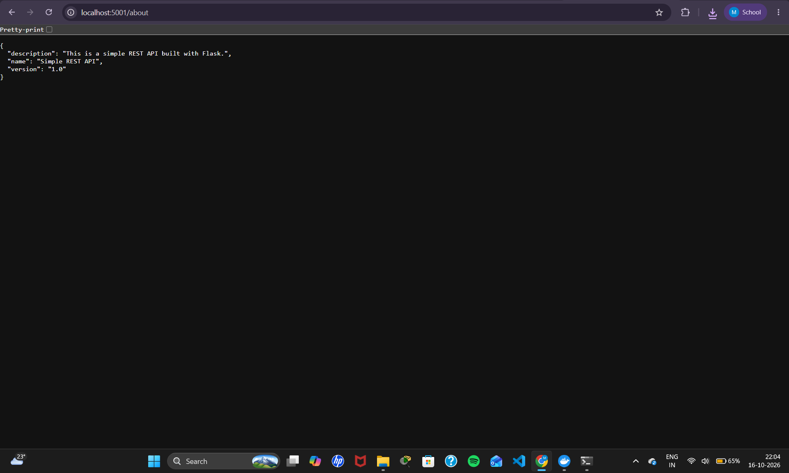
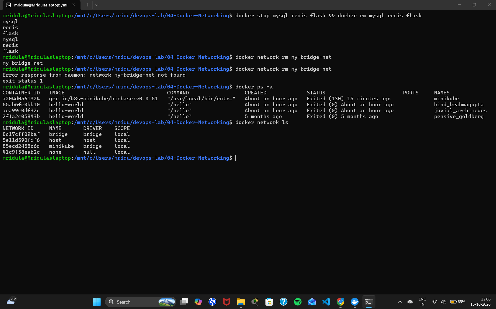

# Exercise 4: Docker Networking with Multiple Containers

## Objective
Understand Docker networking concepts and configure a multi-container application where containers communicate with each other by name over a user-defined bridge network.

## Scenario
A web application made of three containers:
- A Python **Flask** web server (container 1)
- A **MySQL** database (container 2)
- A **Redis** cache (container 3)

## Files
| File | Purpose |
|------|---------|
| `app.py` | Flask REST API with an `/about` endpoint on port 5001 |
| `requirements.txt` | Python dependencies (Flask 2.0.1, Werkzeug 2.0.3) |
| `Dockerfile` | Builds the Flask image (also installs `ping` for connectivity tests) |

## Steps and Commands

### Task 1-3: Create, list and inspect a bridge network
```bash
docker network create --driver bridge my-bridge-net
docker network ls
docker network inspect my-bridge-net
```

### Task 4: Build the Flask image and launch the containers
```bash
docker build -t flask-api .

docker run -d --name mysql --net=my-bridge-net -e MYSQL_ROOT_PASSWORD=root123 mysql:latest
docker run -d --name redis --net=my-bridge-net redis:latest
docker run -d --name flask --net=my-bridge-net -p 5001:5001 flask-api

docker ps
```

### Task 5: Test connectivity between containers
```bash
docker exec -it flask bash
ping mysql     # Ctrl+C to stop
ping redis     # Ctrl+C to stop
exit
```
Open `http://localhost:5001/about` in the browser.

### Task 6: Clean up
```bash
docker stop mysql redis flask && docker rm mysql redis flask
docker network rm my-bridge-net
```

## Changes from the Lab Manual
- `app.run(host='0.0.0.0', ...)`: Flask must listen on all interfaces to be reachable through `-p 5001:5001`.
- `Werkzeug==2.0.3` pinned: Flask 2.0.1 is incompatible with newer Werkzeug versions.
- `MYSQL_ROOT_PASSWORD` set: the MySQL container exits immediately without it.
- `iputils-ping` installed in the image (over https): `python:3.9-slim` does not include `ping`.

## Output Screenshots

### Bridge network created and listed


### Network inspected (subnet and gateway)


### Flask image built


### All three containers running on the network


### Flask container pinging MySQL and Redis by name


### Flask API in browser


### Cleanup


## Q&A
1. **Purpose of the `--net` flag?** It specifies which network to connect the container to.
2. **How do containers communicate on the same network?** Using their container names (Docker's built-in DNS) or IP addresses.
3. **Bridge vs host network?** A bridge network gives containers an isolated private network; a host network shares the host's network stack directly.
4. **How to expose a container port to the host?** Use the `-p` flag, e.g. `-p 5001:5001`.
