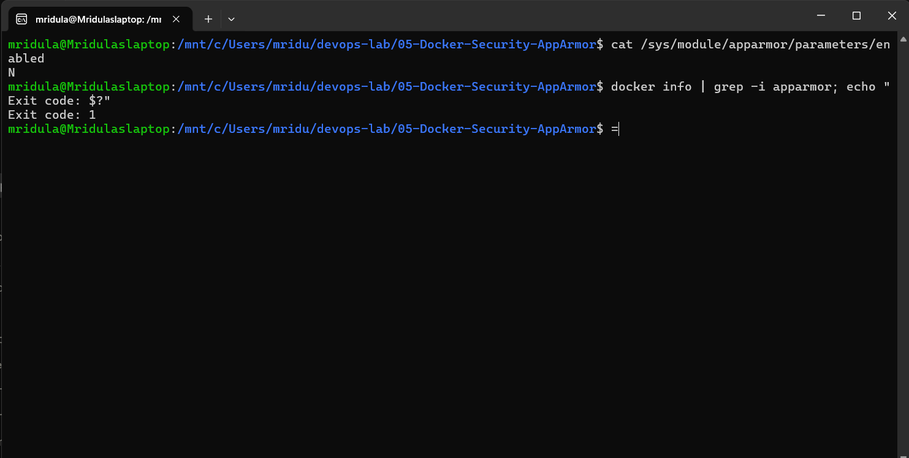
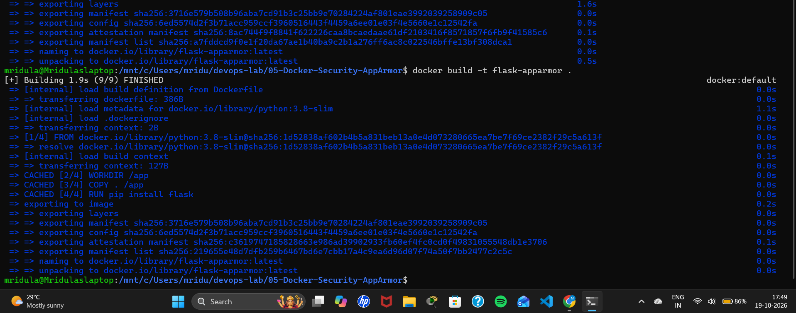
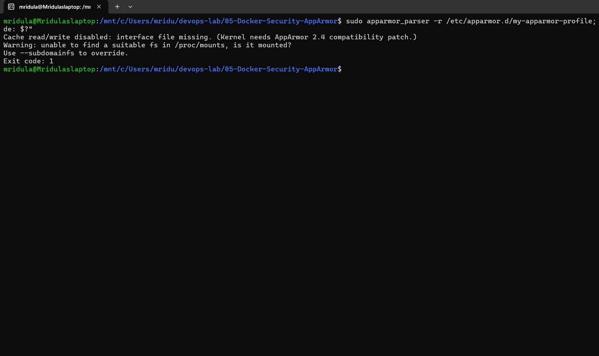
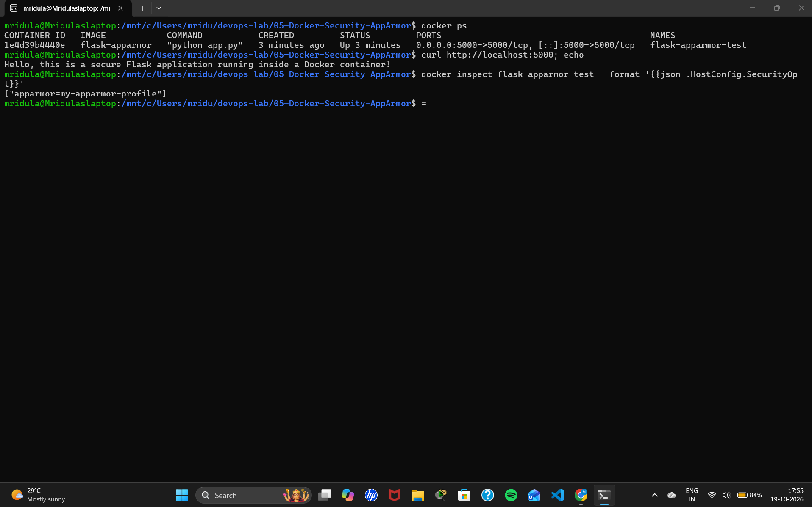
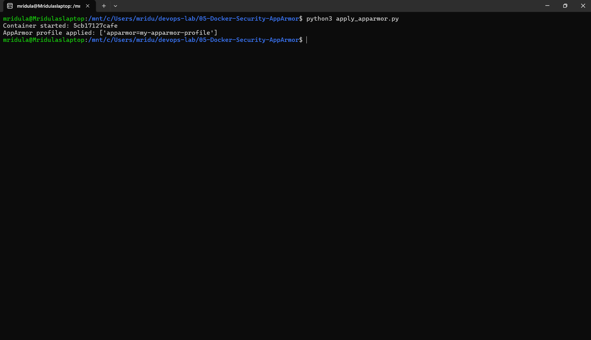
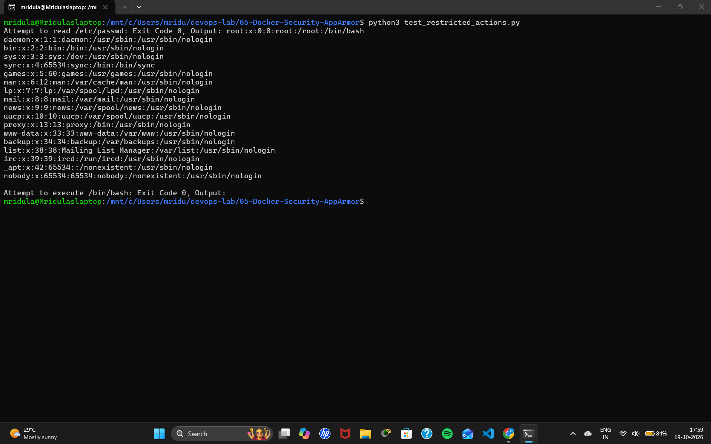

# Exercise 5: Docker Security with AppArmor and Python

## Objective
Secure a Docker container using an AppArmor profile, apply the profile with the Docker SDK for Python, and test restricted actions inside the container.

## Scenario
A Python Flask web application runs inside a Docker container. An AppArmor profile is used to restrict access to sensitive directories (`/etc`, `/var`) and prevent execution of binaries (`/bin`, `/usr/bin`).

## Files
| File | Purpose |
|------|---------|
| `app.py` | Flask app on port 5000 |
| `Dockerfile` | Builds the `flask-apparmor` image |
| `my-apparmor-profile` | AppArmor profile (deny `/etc`, `/var`, `/bin`, `/usr/bin`; allow `/app`) |
| `apply_apparmor.py` | Docker SDK: builds the image, runs the container with the profile, prints the applied SecurityOpt |
| `test_restricted_actions.py` | Docker SDK: tries `cat /etc/passwd` and `/bin/bash` inside the container |

## Environment Limitation: AppArmor Is Not Available on WSL2
This exercise was done on **Windows 11 + WSL2 (Ubuntu) + Docker Desktop**. AppArmor is a Linux kernel security module, and the WSL2 kernel ships with it **disabled**:

~~~bash
cat /sys/module/apparmor/parameters/enabled              # N
docker info | grep -i apparmor; echo "Exit code: $?"     # no match, exit code 1
~~~

All steps of the manual were carried out. The profile is written and the container is run with it, but the kernel cannot load or enforce the profile, so restricted actions are not blocked. On a native Linux host (e.g. Ubuntu) with AppArmor enabled, the same files and commands give the manual's expected results.

## Steps

### Pre-requisite: Install AppArmor utilities
~~~bash
sudo apt-get install -y apparmor-utils
~~~

### Task 1: Flask application
`app.py` returns "Hello, this is a secure Flask application running inside a Docker container!"

### Task 2: Containerize the application
~~~bash
docker build -t flask-apparmor .
~~~

### Task 3: Create and apply the AppArmor profile
~~~bash
sudo cp my-apparmor-profile /etc/apparmor.d/my-apparmor-profile
sudo apparmor_parser -r /etc/apparmor.d/my-apparmor-profile
docker run -d --name flask-apparmor-test --security-opt="apparmor=my-apparmor-profile" -p 5000:5000 flask-apparmor
curl http://localhost:5000
docker inspect flask-apparmor-test --format '{{json .HostConfig.SecurityOpt}}'
~~~
- `apparmor_parser` fails: *"Cache read/write disabled: interface file missing. (Kernel needs AppArmor 2.4 compatibility patch.)"*, exit code 1.
- The container still starts, the app responds, and Docker records `["apparmor=my-apparmor-profile"]`, but the profile is not enforced.

### Task 4: Apply the profile with the Docker SDK for Python
~~~bash
sudo apt-get install -y python3-docker     # equivalent of: pip install docker
python3 apply_apparmor.py
~~~
Output:
~~~
Container started: 5cb17127cafe
AppArmor profile applied: ['apparmor=my-apparmor-profile']
~~~

### Task 5: Test restricted actions
~~~bash
python3 test_restricted_actions.py
~~~
| Action | Expected (AppArmor enforced) | Actual (WSL2, AppArmor disabled) |
|--------|------------------------------|----------------------------------|
| `cat /etc/passwd` | Exit Code 1 (blocked) | Exit Code 0, file contents printed |
| `/bin/bash` | Exit Code 126 (blocked) | Exit Code 0 |

This confirms the profile is only recorded, not enforced, on this platform.

## Output Screenshots

### AppArmor disabled in the kernel and absent from Docker

### Task 2: Image built

### Task 3: apparmor_parser cannot load the profile

### Task 3: Container run with the profile, app working, SecurityOpt recorded

### Task 4: apply_apparmor.py

### Task 5: test_restricted_actions.py (not blocked, because AppArmor is not enforced)

## Q&A
1. **What is the purpose of using AppArmor with Docker containers?** AppArmor enforces security policies that confine an application to a limited set of resources, limiting a container's access to files, networks and system resources.
2. **How do AppArmor profiles help secure a Docker container?** They define what the containerized application can and cannot do: restricting directories, network access, file execution and capabilities.
3. **Why restrict access to `/etc/` and `/var/`?** They contain system configuration and sensitive data; restricting them stops a container from reading or modifying important system files.
4. **What other capabilities can be restricted?** Network access, binding to ports, executing binaries, writing to directories, and admin capabilities such as `sys_admin`.
5. **How do you verify a profile is applied?** Inspect the container (Docker SDK `inspect_container` or `docker inspect`) and check `HostConfig.SecurityOpt`. As this exercise shows, that only proves the option was recorded; enforcement also requires AppArmor to be enabled in the host kernel.
