# Exercise 6: Real-Time Operations Monitoring and Alerting (Prometheus + Grafana + Jenkins)

## Objective
As a DevOps engineer at ZAPPTTO (a fast-paced delivery service), build a monitoring setup that gives real-time insights into delivery performance: simulate delivery metrics with Python, collect them with Prometheus, raise alerts, visualise them on a Grafana dashboard, and automate the deployment with Jenkins.

## Files
| File | Purpose |
|------|---------|
| `delivery_metrics.py` | Python app that simulates delivery metrics every second and exposes them at `/metrics` on port 8000 |
| `prometheus.yml` | Prometheus scrape config (scrapes itself and the delivery service) |
| `alert_rules.yml` | Alert rules: HighPendingDeliveries and HighAverageDeliveryTime |
| `grafana-dashboard.json` | Grafana dashboard with the 4 panels from the manual |
| `Dockerfile` | Builds the delivery metrics app into an image (used by the Jenkins pipeline) |
| `Jenkinsfile` | The manual's Jenkins pipeline (Step 5b), with only the lines that can't run as written changed |

## Metrics
| Metric | Type | Meaning |
|--------|------|---------|
| `total_deliveries` | Gauge | Total number of deliveries |
| `pending_deliveries` | Gauge | Number of pending deliveries |
| `on_the_way_deliveries` | Gauge | Number of deliveries on the way |
| `average_delivery_time` | Summary | Delivery time in seconds (`_sum` / `_count` gives the average) |

## Steps and Commands

### Step 1: Run the Python application
```bash
sudo apt install -y python3-prometheus-client
python3 delivery_metrics.py
```
Metrics: `http://localhost:8000/metrics`

### Step 2: Configure and run Prometheus
`prometheus.yml`:
```yaml
scrape_configs:
  - job_name: "prometheus"
    static_configs:
      - targets: ["localhost:9090"]

  - job_name: "delivery_service"
    static_configs:
      - targets: ["host.docker.internal:8000"]

rule_files:
  - /etc/prometheus/alert_rules.yml
```
Run Prometheus:
```bash
docker run -d --name prometheus -p 9090:9090 --add-host=host.docker.internal:host-gateway -v ./prometheus.yml:/etc/prometheus/prometheus.yml -v ./alert_rules.yml:/etc/prometheus/alert_rules.yml prom/prometheus
```
- Targets: `http://localhost:9090/targets`
- Alerts: `http://localhost:9090/alerts`

### Step 3: Set up Grafana
```bash
docker run -d --name grafana -p 3000:3000 grafana/grafana
docker ps
```
- Open `http://localhost:3000`, log in with `admin` / `admin`, and skip the password update
- Connections → Data sources → Add data source → Prometheus → URL `http://host.docker.internal:9090` → Save & test
- Dashboards → New → Import → upload `grafana-dashboard.json` → Import. Panels:
  - Total Deliveries (`total_deliveries`)
  - Pending Deliveries (`pending_deliveries`)
  - On-the-Way Deliveries (`on_the_way_deliveries`)
  - Average Delivery Time (`average_delivery_time_sum / average_delivery_time_count`)

## Changes from the Lab Manual (Windows + Docker Desktop)
- The manual's own note says to use **`host.docker.internal`** on Windows, and `172.17.0.1` on Linux. This was done on Windows with Docker Desktop, so the Prometheus target is `host.docker.internal:8000` and the Grafana data source is `http://host.docker.internal:9090`.
- `--network=host` doesn't publish ports with Docker Desktop on Windows, so Prometheus is run with `-p 9090:9090` and `--add-host=host.docker.internal:host-gateway` instead. Everything else in the command is the same as the manual's.
- `prometheus-client` is installed with `apt` because newer Ubuntu blocks system-wide `pip install`.
- The dashboard panels were saved in `grafana-dashboard.json` and imported, instead of being created by hand (same 4 panels and queries as the manual).

## Output Screenshots

### Step 1: Delivery metrics app running
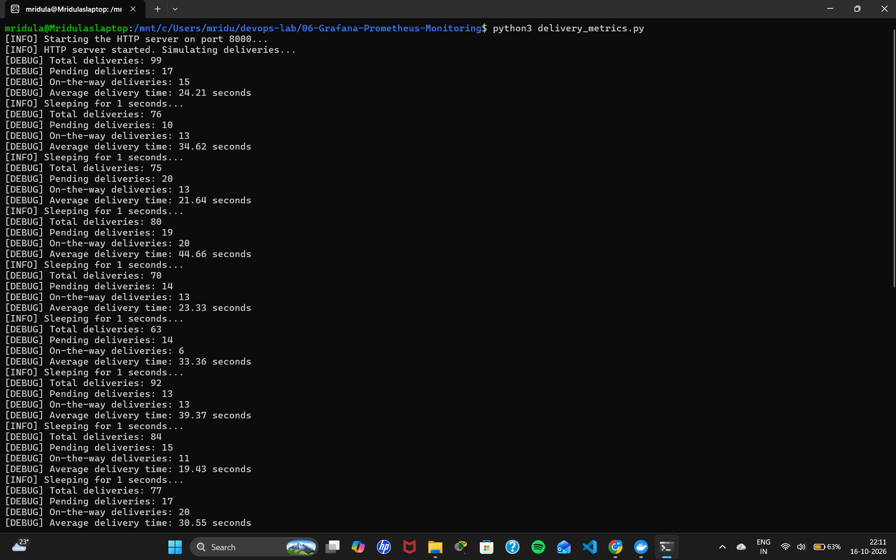

### Step 1: Metrics endpoint
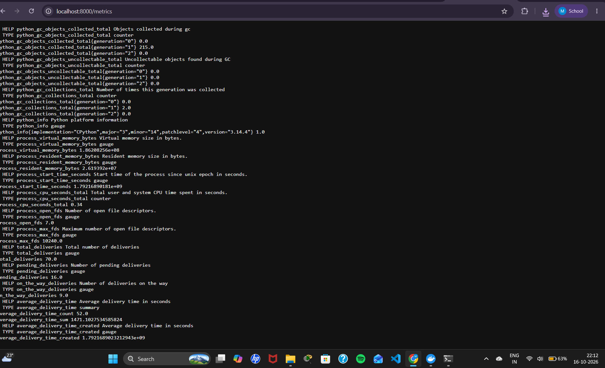

### Prometheus and Grafana containers running
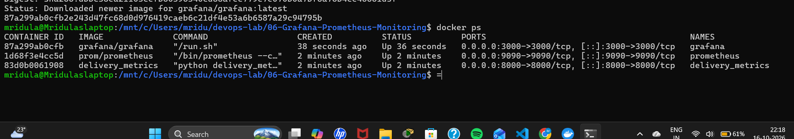

### Prometheus targets UP (delivery_service via host.docker.internal:8000)
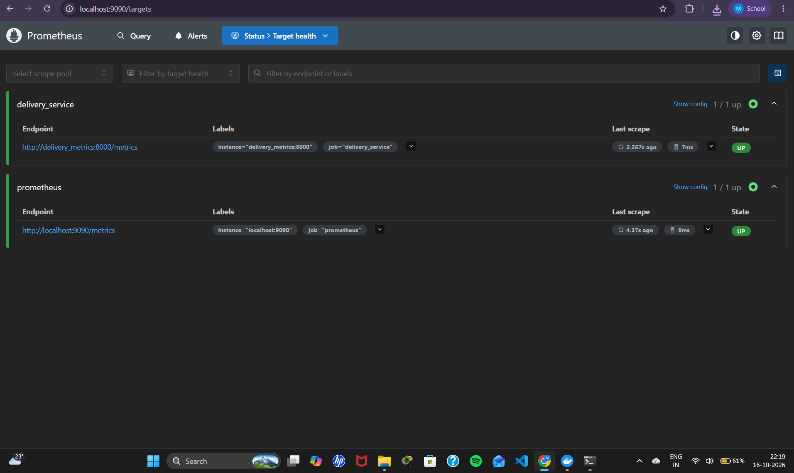

### Prometheus alert rules loaded
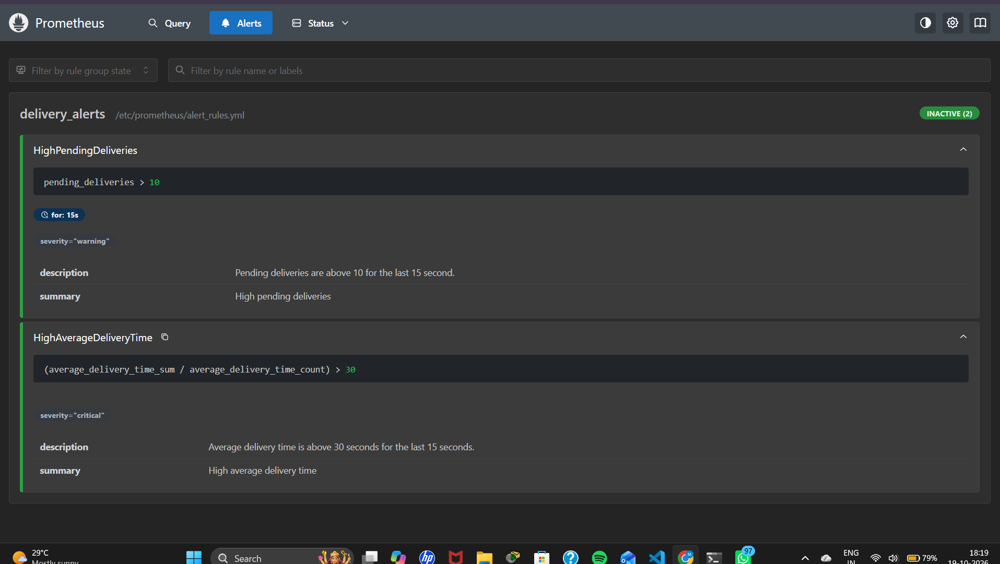

### Grafana connected to Prometheus
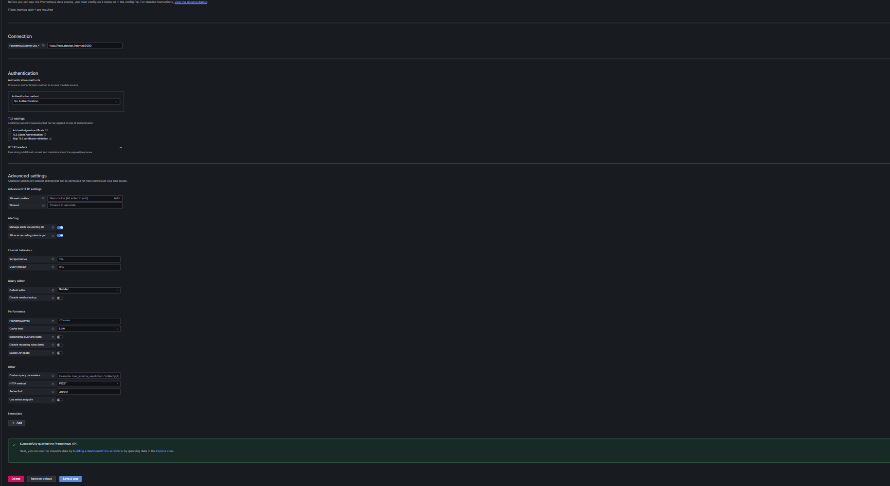

### Grafana delivery monitoring dashboard
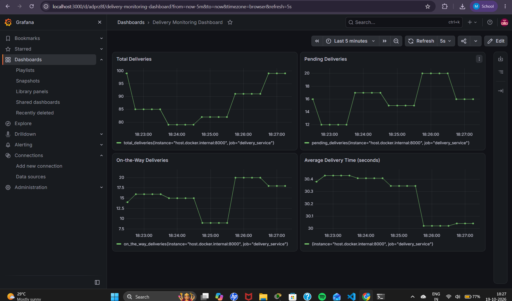

## Step 5: Jenkins Pipeline

The whole monitoring stack is deployed automatically by a Jenkins pipeline defined in `Jenkinsfile`.

### Setup
Jenkins runs in Docker with access to the host's Docker engine:
~~~bash
docker run -d --name jenkins -u root -p 8080:8080 -p 50000:50000 \
  -v jenkins_home:/var/jenkins_home \
  -v /var/run/docker.sock:/var/run/docker.sock \
  jenkins/jenkins:lts

docker exec jenkins bash -c "apt-get update && apt-get install -y docker-cli"
docker exec jenkins git config --global --add safe.directory '*'
~~~

### Pipeline job
- New Item → `Delivery-Monitoring-Pipeline` → **Pipeline**
- Pipeline script from SCM → Git → `https://github.com/mridulaachar3/devops-lab.git`, branch `*/main`
- Script Path: `06-Grafana-Prometheus-Monitoring/Jenkinsfile`

### Stages
| Stage | What it does |
|-------|-------------|
| Pre-check Docker | Checks Docker is installed and the daemon is running |
| Setup Workspace | Copies `delivery_metrics.py`, `prometheus.yml`, `alert_rules.yml` (and the `Dockerfile`) into the Jenkins workspace |
| Build Docker Image | `docker build -t delivery_metrics .` |
| Run Application | `docker run -d -p 8000:8000 --name delivery_metrics delivery_metrics` |
| Run Prometheus & Grafana | Starts Prometheus with the two config files, and Grafana |

> The Jenkinsfile is the manual's Step 5b file with the same 5 stages. Only 3 things were changed, because they can't run as written:
> - `localSourcePath` points to the folder checked out from GitHub instead of the placeholder `/path/to/your/local/files`.
> - `Dockerfile` is also copied into the workspace, so `docker build -t delivery_metrics .` finds it.
> - Prometheus is started with `docker create` + `docker cp` (the two yml files) + `docker start` instead of `-v $WORKSPACE/...` bind mounts. Jenkins runs inside Docker, so `$WORKSPACE` paths exist only inside the Jenkins container, not on the Docker host that would mount them.
>
> Before each run, old containers are removed with `docker rm -f delivery_metrics prometheus grafana`, because the manual's pipeline starts them with fixed names.

### Jenkins pipeline configuration
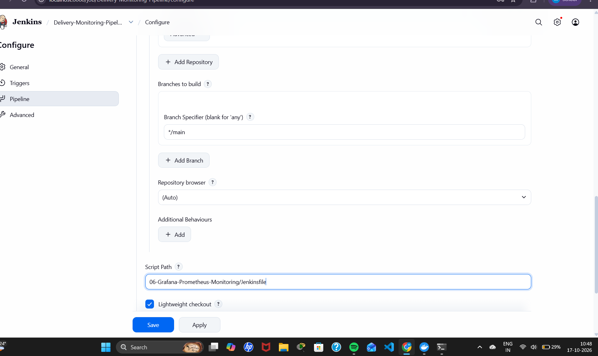

### All pipeline stages passed
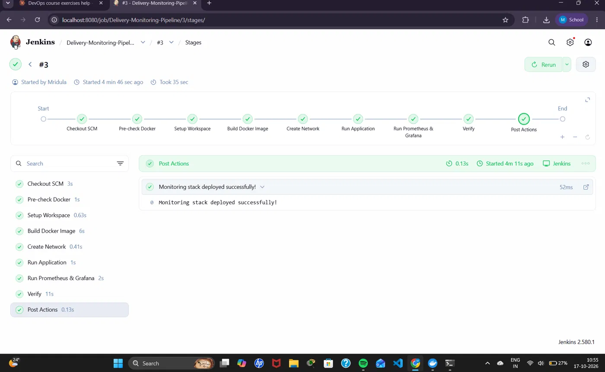

### Jenkins logs: successful pipeline build
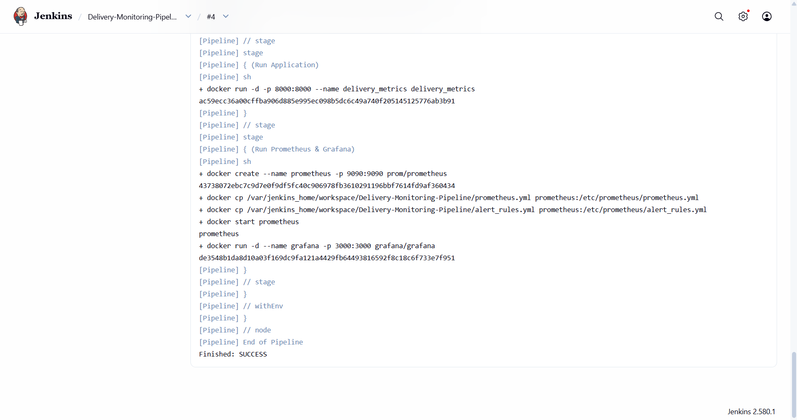

## Step 6: Simulate Alerts

`delivery_metrics.py` was modified to increase pending deliveries above the alert threshold:
~~~python
pending = random.randint(50, 100)  # Increase range to exceed alert threshold
~~~
Then the Python script and Prometheus were restarted, as the manual says:
~~~bash
# Ctrl + C to stop the old script, then:
python3 delivery_metrics.py

docker restart prometheus
~~~
Result: `pending_deliveries` jumps from 10-20 to 50-100, and the **HighPendingDeliveries** alert fires in both the Prometheus UI and Grafana. `HighAverageDeliveryTime` stays normal, because only the pending range was changed. (The file in this repo was set back to `randint(10, 20)` afterwards, to match Step 1.)

### Code changed to 50-100 and script restarted
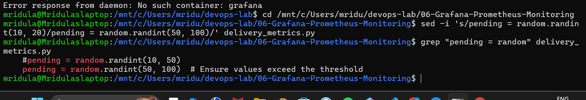

### Prometheus graph: pending_deliveries jumps above the threshold
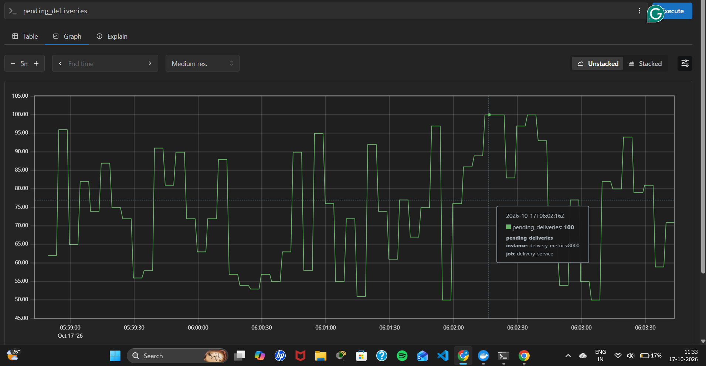

### Prometheus UI: HighPendingDeliveries firing
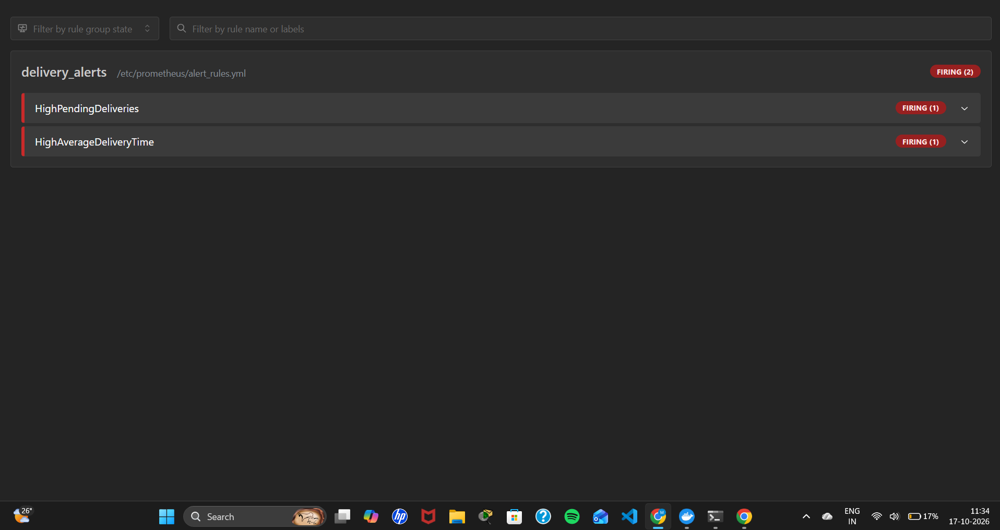

### Grafana: HighPendingDeliveries firing
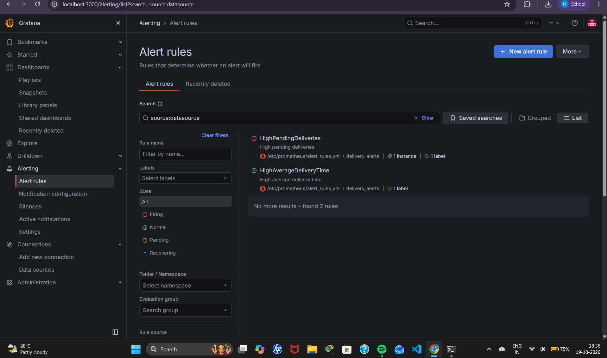

### Expected Output 2: Prometheus query graphs
The manual's Expected Outputs ask for Prometheus graphs of `total_deliveries`, `pending_deliveries` and `average_delivery_time`. The `pending_deliveries` graph is shown above.

`total_deliveries`:
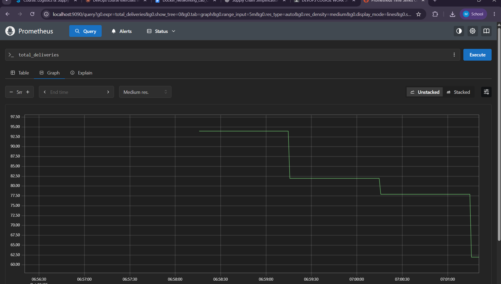

`average_delivery_time_sum / average_delivery_time_count`:
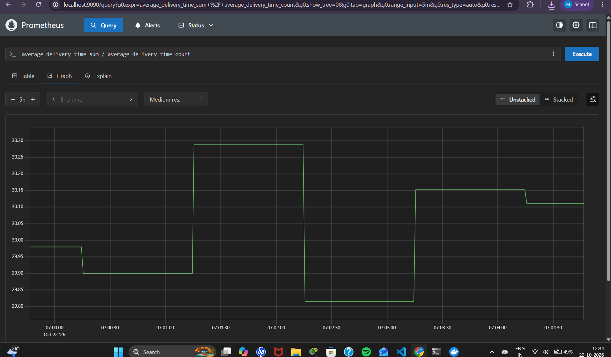

## Learnings
- `start_http_server` from `prometheus_client` automatically creates the `/metrics` endpoint.
- Metric types: **Counter** (only goes up), **Gauge** (goes up and down), **Histogram** (bucketed distribution), **Summary** (count/sum/quantiles).
- Prometheus **scrapes** (pulls) metrics from targets at a fixed interval and evaluates **alert rules** on them. An alert goes from Inactive → Pending → Firing after its `for:` time.
- `host.docker.internal` lets a container reach a service running on the host machine.
- Grafana uses Prometheus as a **data source**, shows the queries as dashboard panels, and also lists Prometheus alert rules.
- Jenkins can automate the whole build-and-deploy of the monitoring stack.
