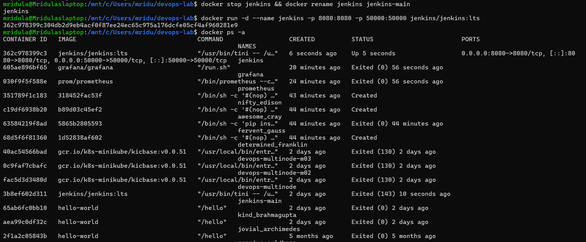
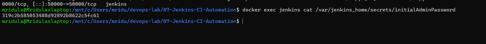
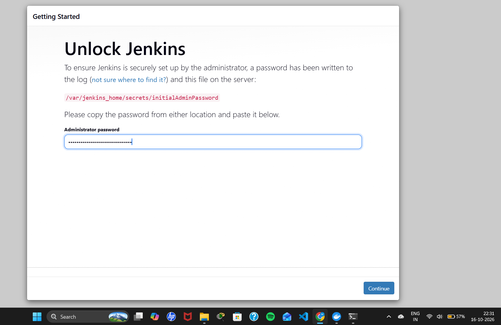
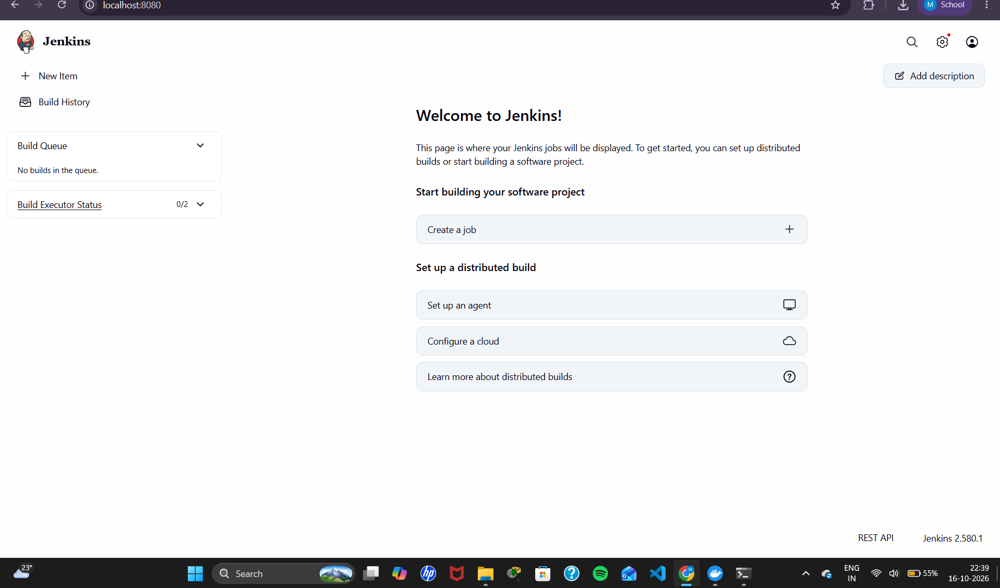
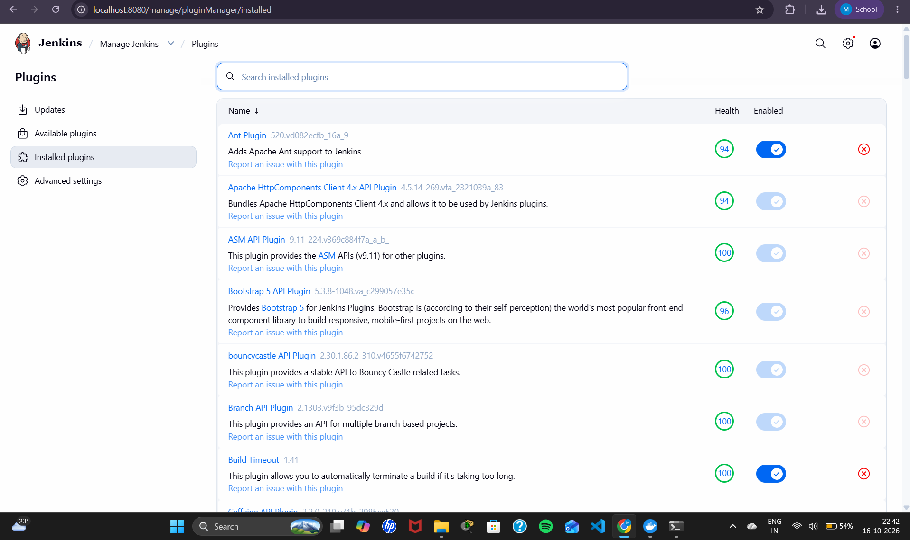

# Exercise 7: Introduction to Continuous Integration (CI) and Jenkins Installation

## Objective
Understand Continuous Integration (CI) and install Jenkins using Docker, unlock it, install plugins, and reach the Jenkins dashboard.

## What is Continuous Integration?
CI is the practice of frequently merging code changes into a shared repository, where every change is automatically built and tested.
- **Workflow:** Code change → push to Git → CI server triggers a build → automated tests run → developers get feedback.
- **Benefits:** early bug detection, faster feedback, always-releasable code, less integration pain.
- **CI tools:** Jenkins, GitHub Actions, GitLab CI/CD, CircleCI, Travis CI, Azure Pipelines, Bamboo, TeamCity.

## What is Jenkins?
Jenkins is an open-source automation server used to build, test and deploy software (CI/CD).

| Concept | Meaning |
|---------|---------|
| Job / Project | A task Jenkins runs |
| Build | One execution of a job |
| Pipeline | A series of stages (build, test, deploy) defined as code |
| Plugins | Extensions that add features (Git, Pipeline, etc.) |
| Nodes | Machines where jobs run (controller / agents) |

## More from the Manual: CI and Jenkins Theory

### Key features of CI
1. **Frequent code integration:** developers commit code to a shared repository multiple times a day.
2. **Automated builds:** every commit triggers an automated build to verify the change.
3. **Automated testing:** automated tests run as part of CI to make sure functionality stays intact.
4. **Immediate feedback:** developers get quick feedback and can fix issues promptly.

### Benefits of CI
- **Early bug detection:** integration issues are found early, which reduces the cost of fixing bugs.
- **Improved collaboration:** developers work on the same codebase and changes are integrated smoothly.
- **Faster development cycles:** automated builds and tests speed up development.
- **High-quality code:** continuous testing keeps quality high and prevents regressions.

### How CI works
1. **Developer workflow:** developers write code and push changes to the version control system (e.g. Git).
2. **CI server workflow:** the CI server (e.g. Jenkins, GitLab CI) detects the change and triggers the build.
3. **Automated build:** the code is compiled, dependencies are resolved and the application is built.
4. **Automated testing:** unit tests, integration tests and other automated tests verify functionality.
5. **Feedback:** the result (success or failure) is sent back to the developers.

### CI tools (the manual's list of 10)
| # | Tool | Overview |
|---|------|----------|
| 1 | GitLab CI/CD | Part of GitLab's platform; CI/CD integrated directly with Git repositories |
| 2 | CircleCI | Cloud-based CI/CD tool, easy to integrate with GitHub and Bitbucket |
| 3 | Travis CI | CI service for open-source and private projects, popular in open source |
| 4 | Bamboo | CI/CD tool by Atlassian, integrates with JIRA and Bitbucket |
| 5 | TeamCity | CI/CD server from JetBrains with many integrations and advanced features |
| 6 | Azure DevOps (Pipelines) | Microsoft's CI/CD pipelines, part of its DevOps suite |
| 7 | GitHub Actions | GitHub's CI/CD solution for automating workflows from your repositories |
| 8 | Spinnaker | Open-source continuous delivery and application management tool for cloud-native applications |
| 9 | Buildkite | Hybrid CI/CD platform that runs pipelines on your own infrastructure with scalability |
| 10 | Drone | Modern CI/CD platform that uses a lightweight, containerized approach to build pipelines |

### CI workflow example
1. **Code change:** a developer pushes code to a Git repository.
2. **Trigger build:** the CI server detects the push and triggers a build.
3. **Run tests:** automated tests validate the code.
4. **Feedback:** developers get feedback about the build and test results.

### Why use Jenkins?
- **Automation:** automates repetitive tasks.
- **Continuous integration:** ensures that code changes integrate smoothly.
- **Extensibility:** supports plugins for various tools and services.
- **Scalability:** can run distributed builds on multiple machines.

## Steps and Commands

### 1. Run Jenkins in Docker
```bash
docker run -d --name jenkins -p 8080:8080 -p 50000:50000 jenkins/jenkins:lts
docker ps -a
```
- `-p 8080:8080`: Jenkins web UI
- `-p 50000:50000`: agent communication port
- (Exercises 6, 8 and 9 reuse a Jenkins started with `-v jenkins_home:/var/jenkins_home` so jobs survive restarts)

### 2. Get the initial admin password
```bash
docker exec -it <container-id> bash
cat /var/jenkins_home/secrets/initialAdminPassword
```

### 3. Unlock Jenkins
Open `http://localhost:8080`, paste the password, then continue through setup: create the first admin user and keep the instance URL as `http://localhost:8080/`.

### 4. Install plugins
The "Install suggested plugins" step failed on this network (plain-http mirror downloads are blocked), so the same suggested plugins were installed with the Jenkins Plugin CLI from the https archive server:
```bash
docker exec -e JENKINS_UC_DOWNLOAD_URL=https://archives.jenkins.io/plugins jenkins \
  jenkins-plugin-cli --plugin-download-directory /var/jenkins_home/plugins \
  --plugins cloudbees-folder antisamy-markup-formatter build-timeout credentials-binding \
  timestamper ws-cleanup ant gradle workflow-aggregator github-branch-source \
  pipeline-github-lib pipeline-graph-view git ssh-slaves matrix-auth ldap email-ext mailer dark-theme

docker restart jenkins
```

## Output Screenshots

### Jenkins container running


### Initial admin password


### Unlock Jenkins page


### Jenkins dashboard


### Installed plugins

