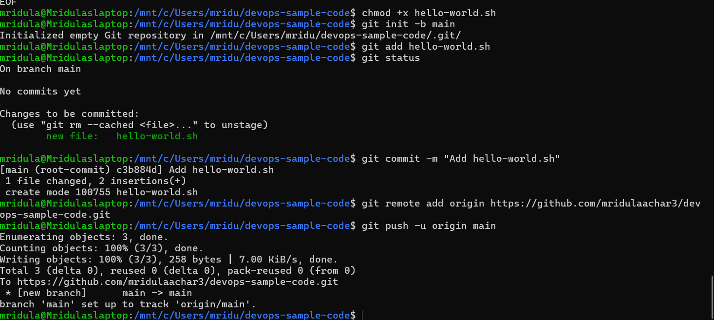
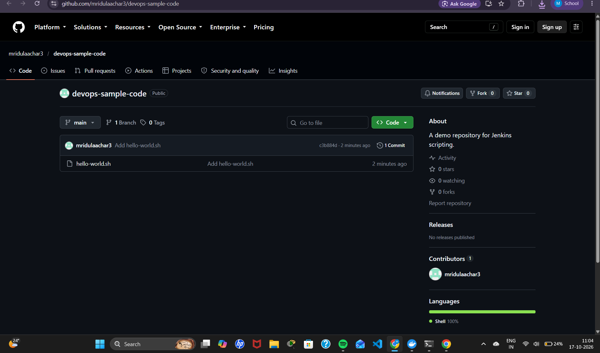

# Exercise 8: Creating a "Hello World" Jenkins Job

## Objective
Create a shell script, push it to a new GitHub repository, and create a Jenkins Freestyle job that pulls the script from GitHub and runs it.

## Repository used by Jenkins
**https://github.com/mridulaachar3/devops-sample-code** (created as per Step 1a of the manual)

A copy of `hello-world.sh` is also kept in this folder for reference.

## Steps

### 1a. Create a new GitHub repository
- Name: `devops-sample-code`
- Description: `A demo repository for Jenkins scripting.`
- Visibility: Public

### 1b. Authentication
GitHub authentication is done with the GitHub CLI (`gh auth login`) instead of a personal access token.

### 2. Create the script locally
~~~bash
cat > hello-world.sh << 'SCRIPT'
#!/bin/bash
echo "Hello, Jenkins!"
SCRIPT
chmod +x hello-world.sh
~~~

### 3-6. Initialise Git, commit and push
~~~bash
git init -b main
git add hello-world.sh
git status
git commit -m "Add hello-world.sh"
git remote add origin https://github.com/mridulaachar3/devops-sample-code.git
git push -u origin main
~~~

### 7. Verify the script on GitHub
`hello-world.sh` is visible in the `devops-sample-code` repository.

## Jenkins Job
- **New Item** → `HelloWorld` → **Freestyle project**
- **Description:** `Hello World! Jenkins job.`
- **Source Code Management:** Git → `https://github.com/mridulaachar3/devops-sample-code.git`, branch `*/main`
- **Build Steps:** Execute shell → `sh hello-world.sh`
- **Save → Build Now → Console Output**

## Output
~~~
Started by user Mridula
Fetching upstream changes from https://github.com/mridulaachar3/devops-sample-code.git
Commit message: "Add hello-world.sh"
+ sh hello-world.sh
Hello, Jenkins!
Finished: SUCCESS
~~~

## Output Screenshots

### New repository devops-sample-code

### Script created, committed and pushed

### Script verified on GitHub

### Source Code Management configuration

### Execute shell build step

### Console output: Hello, Jenkins!

### Successful build on the job page

