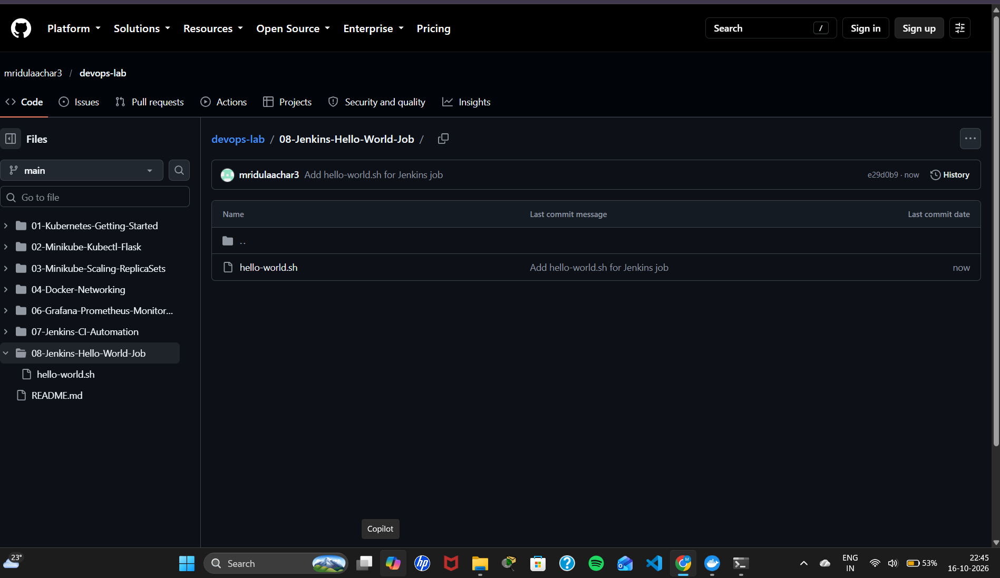
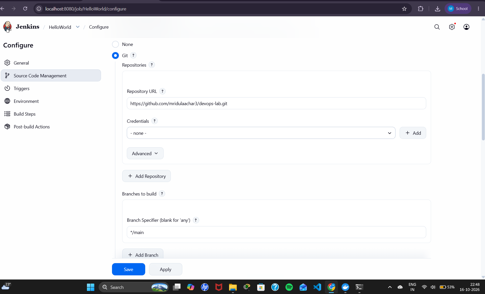
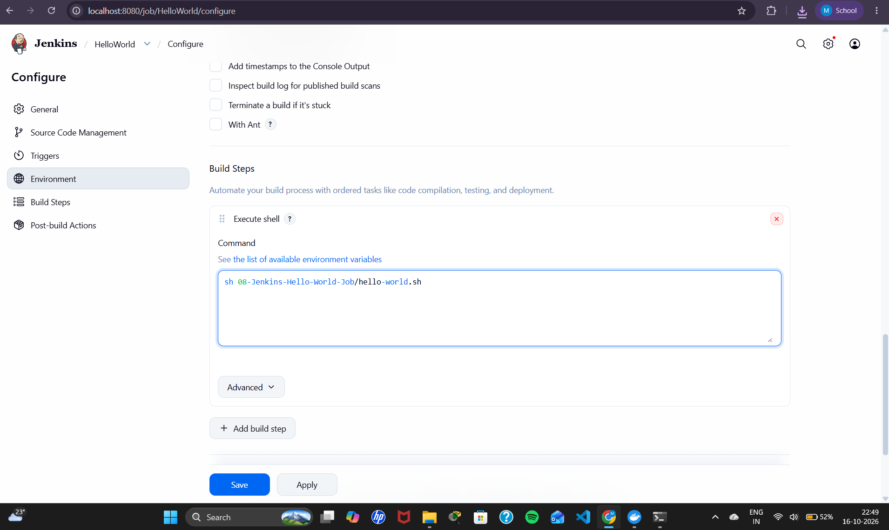
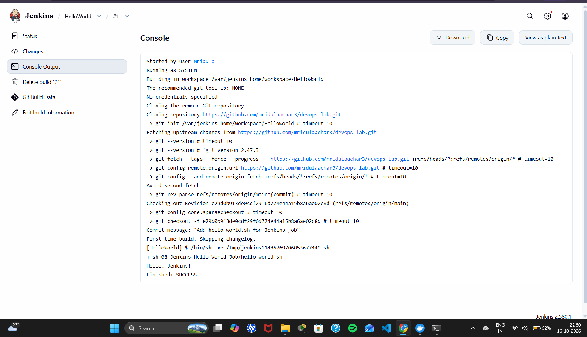
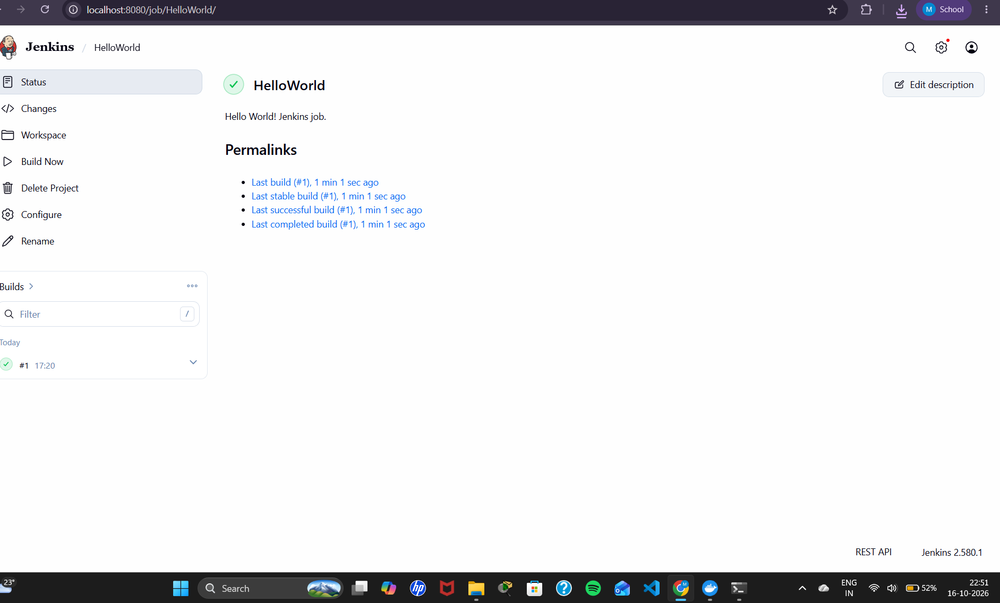

# Exercise 8: Creating a "Hello World" Jenkins Job

## Objective
Create a shell script, push it to GitHub, and create a Jenkins Freestyle job that pulls the script from GitHub and runs it.

## Files
| File | Purpose |
|------|---------|
| `hello-world.sh` | Shell script that prints "Hello, Jenkins!" |

## Steps

### 1. Create the script and push it to GitHub
~~~bash
chmod +x hello-world.sh
./hello-world.sh
git add .
git commit -m "Add hello-world.sh for Jenkins job"
git push
~~~
Note: the script is kept in this `devops-lab` repository (folder `08-Jenkins-Hello-World-Job`) so all exercises are in one place.

### 2. Create a Freestyle job in Jenkins
- New Item → name `HelloWorld` → Freestyle project → OK
- Description: `Hello World! Jenkins job.`

### 3. Configure Source Code Management
- Git → Repository URL: `https://github.com/mridulaachar3/devops-lab.git`
- Credentials: none (public repository)
- Branch Specifier: `*/main`

### 4. Add a build step
- Add build step → Execute shell: `sh 08-Jenkins-Hello-World-Job/hello-world.sh`

### 5. Save and run
- Save → Build Now → #1 → Console Output
- Output: `Hello, Jenkins!` and `Finished: SUCCESS`

## Output Screenshots

### Script on GitHub

### Source Code Management configuration

### Execute shell build step

### Console output: Hello, Jenkins!

### Successful build on the job page

