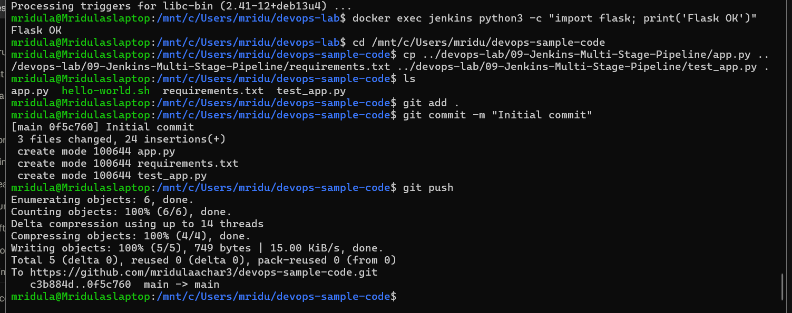
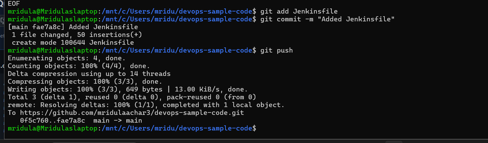
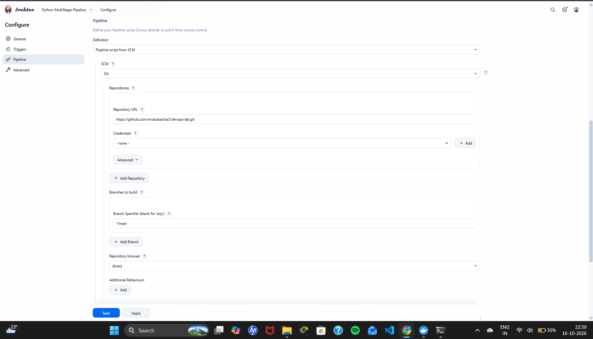
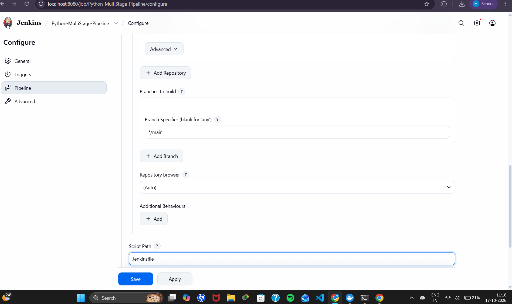
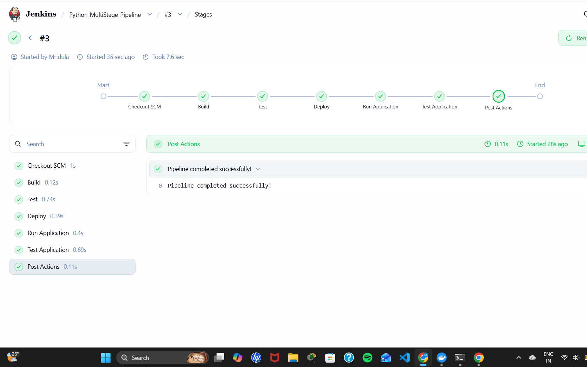
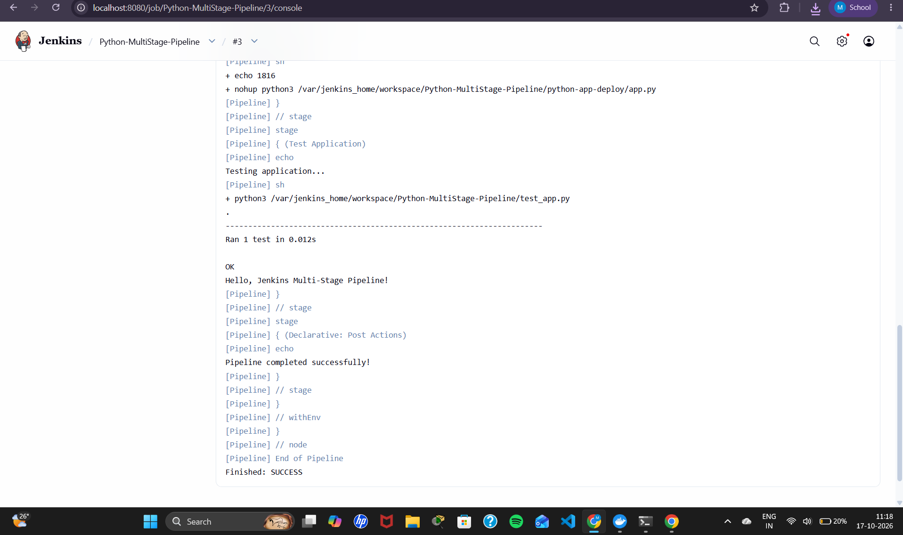
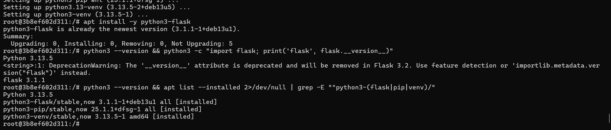
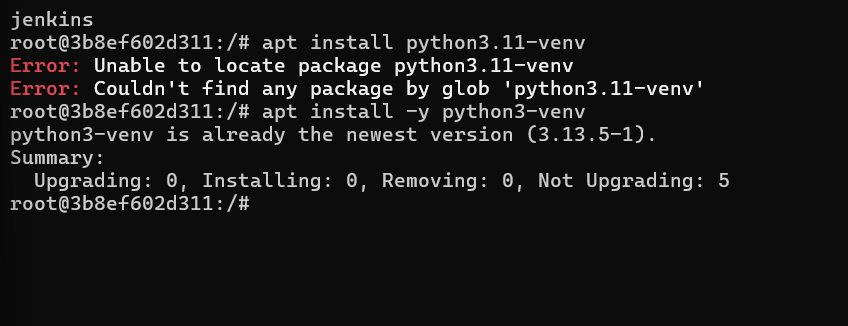

# Exercise 9: Jenkins Multi-Stage Pipeline (Deploying a Python Application)

## Objective
Create and run a Jenkins Pipeline with multiple stages (Build, Test, Deploy, Run Application, Test Application) for a Python Flask app, with the pipeline defined as code in a `Jenkinsfile`.

## Repository used by Jenkins
**https://github.com/mridulaachar3/devops-sample-code** (same repository as Exercise 8, as per the manual)

Copies of all files are kept in this folder for reference.

## Files
| File | Purpose |
|------|---------|
| `app.py` | Flask app returning "Hello, Jenkins Multi-Stage Pipeline!" |
| `requirements.txt` | `flask==2.1.2` |
| `test_app.py` | Unit test that checks the home page response |
| `Jenkinsfile` | Declarative multi-stage pipeline (exactly as in the manual) |

## Pipeline Stages
| Stage | What it does |
|-------|-------------|
| Build | Prints the build message |
| Test | Runs unit tests: `python3 -m unittest discover -s .` |
| Deploy | Copies `app.py` to `${WORKSPACE}/python-app-deploy` |
| Run Application | Starts the app in the background with `nohup` and saves its PID |
| Test Application | Runs `python3 ${WORKSPACE}/test_app.py` |
| Post Actions | Prints success or failure message |

## Steps

### Step 1-2: Set up Jenkins and create the app files
Jenkins runs in Docker (see Exercise 7). Files: `app.py`, `requirements.txt`, `test_app.py`.

### Step 3: Push the application to GitHub
~~~bash
git add .
git commit -m "Initial commit"
git push
~~~

### Step 4: Create the pipeline job
New Item → `Python-MultiStage-Pipeline` → **Pipeline** → OK

### Step 5: Add the Jenkinsfile and push it
~~~bash
git add Jenkinsfile
git commit -m "Added Jenkinsfile"
git push
~~~

### Step 6: Configure the job
- Definition: **Pipeline script from SCM**
- SCM: **Git**, URL `https://github.com/mridulaachar3/devops-sample-code.git`, no credentials
- Branch Specifier: `*/main`
- Script Path: `Jenkinsfile`

### Step 7: Run the pipeline
**Build Now** → all stages pass.

### Step 8: Handling build errors
The Jenkins image has no Python, so the first build fails. As in the manual, log into the Jenkins container as root and install the dependencies:
~~~bash
docker ps -a
docker exec -it -u root <container-id> bash
~~~
Inside the container shell (`root@<container-id>:/#`):
~~~bash
apt-get update
apt install -y python3
apt install -y python3-pip
apt install -y python3-venv      # manual says python3.11-venv; this Jenkins image ships Python 3.13
apt install -y python3-flask
~~~
> Flask is installed with `apt` (`python3-flask`) because newer Debian blocks system-wide `pip install`.

The manual's exact `apt install python3.11-venv` was tried first. It fails with `Unable to locate package python3.11-venv`, because this Jenkins image ships Python 3.13, so `python3-venv` (the matching version) is used instead.

## Output Screenshots

### App files pushed to devops-sample-code

### Jenkinsfile pushed

### Pipeline job configuration (repository URL)

### Script Path

### All stages passed

### Console output: tests OK and Finished SUCCESS

### Step 8: Python, pip, venv and Flask installed inside the Jenkins container

### Step 8: manual's python3.11-venv not available, python3-venv used instead

