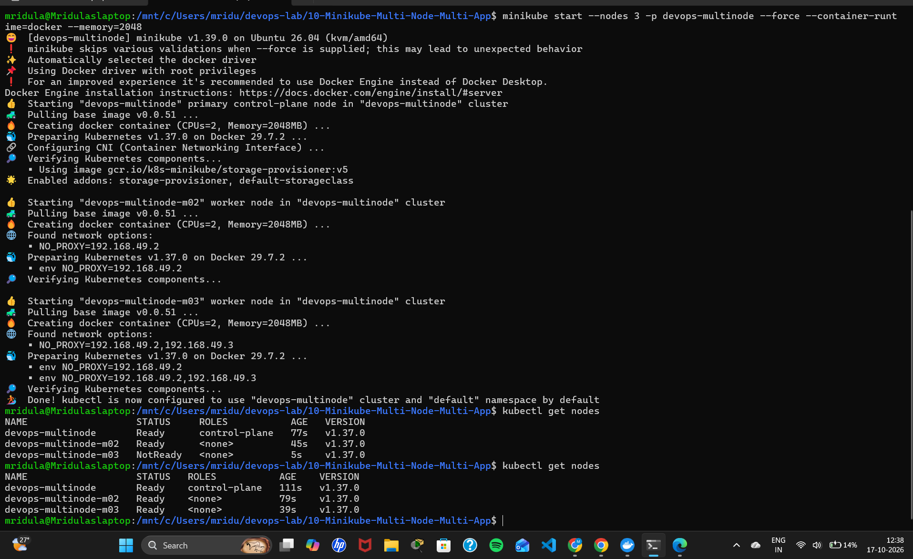
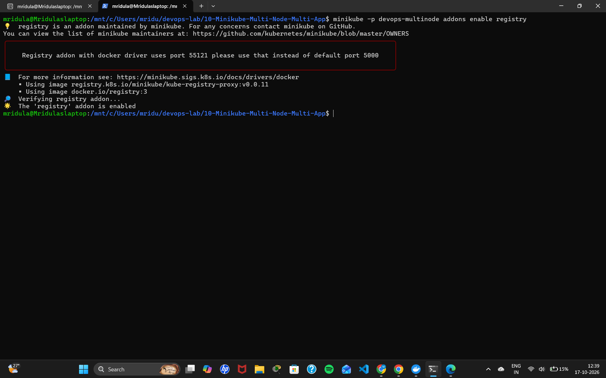
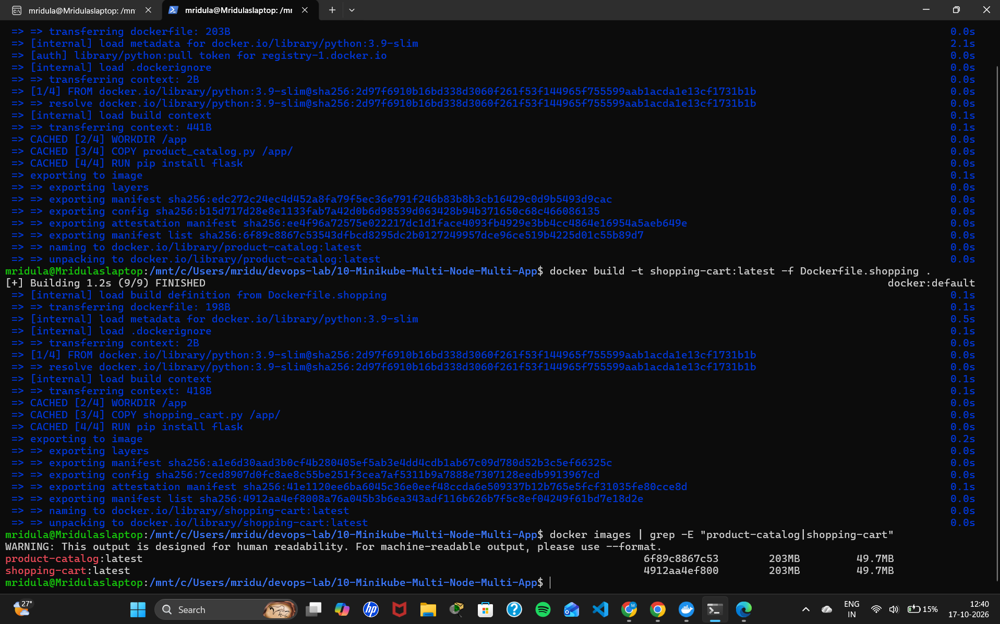
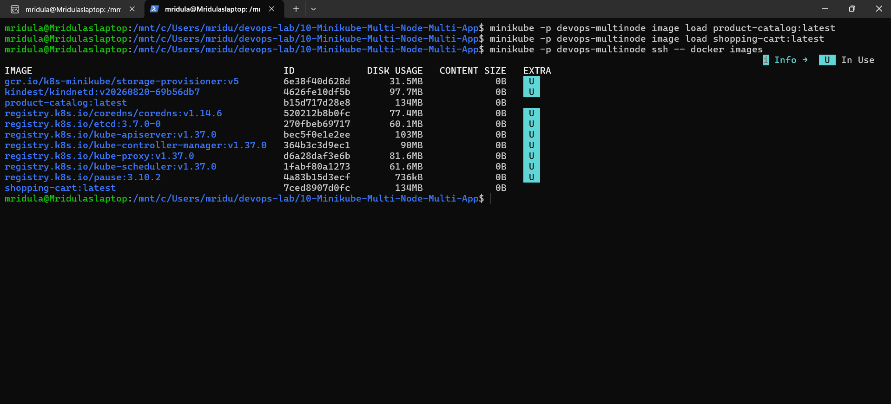
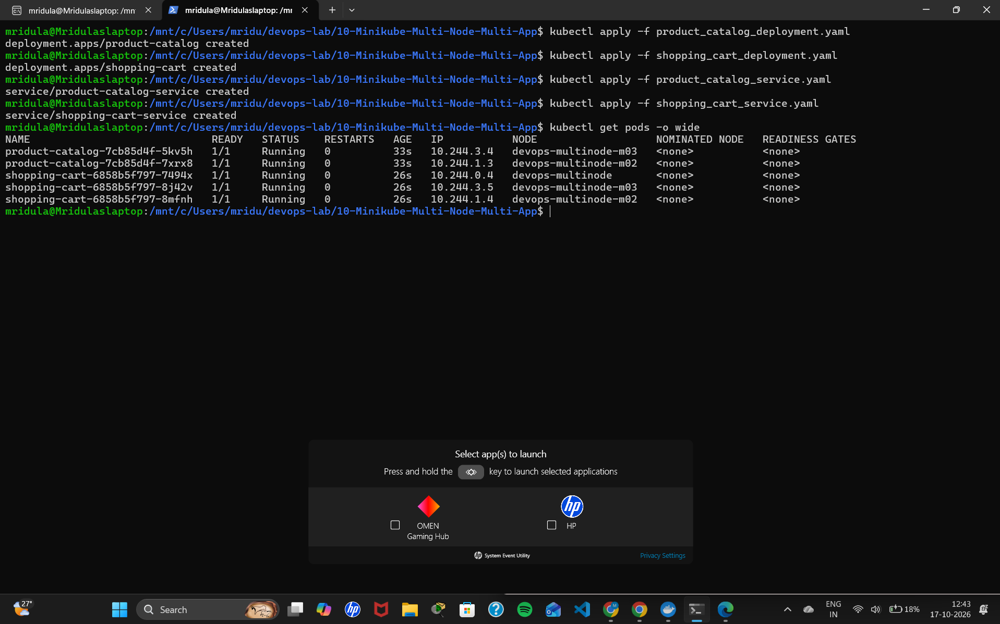
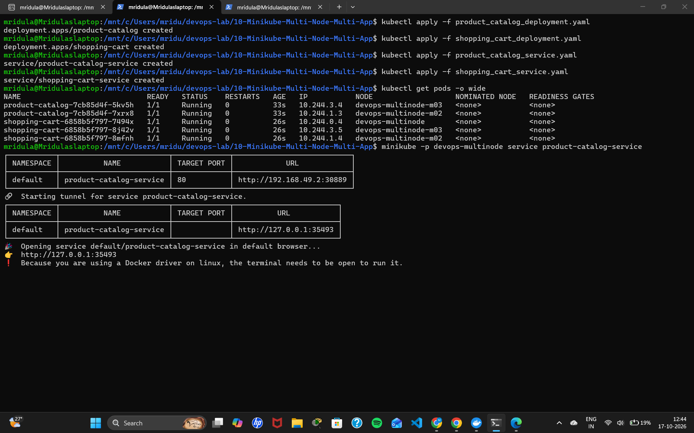
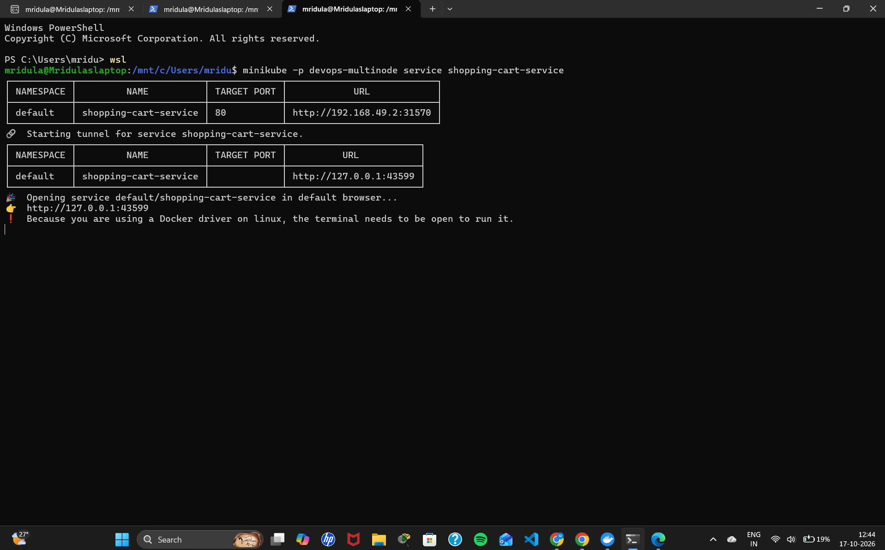
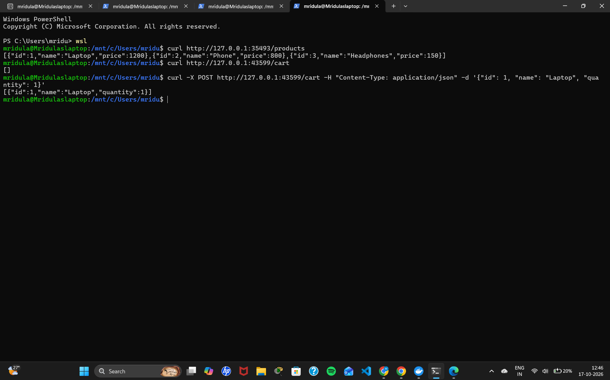

# Exercise 10: Multi-Node Kubernetes Cluster with Multiple Applications and ReplicaSets

## Storyboard
An e-commerce platform with two services:
1. **Product Catalog** (AppA): lists available products, **2 replicas**
2. **Shopping Cart** (AppB): manages user carts, **3 replicas**

Replicas of each service are spread across multiple nodes (pod anti-affinity), so the store stays available even if one node fails.

## Files
| File | Purpose |
|------|---------|
| `product_catalog.py` | Flask app: `GET /products` |
| `shopping_cart.py` | Flask app: `GET /cart`, `POST /cart` |
| `Dockerfile.product` | Image for Product Catalog |
| `Dockerfile.shopping` | Image for Shopping Cart |
| `product_catalog_deployment.yaml` | Deployment, 2 replicas, pod anti-affinity |
| `shopping_cart_deployment.yaml` | Deployment, 3 replicas, pod anti-affinity |
| `product_catalog_service.yaml` | NodePort Service |
| `shopping_cart_service.yaml` | NodePort Service |

## Steps

### Step 0: Clean up any existing Minikube
~~~bash
minikube stop
minikube delete
~~~

### Step 1a: Start Minikube with 3 nodes
~~~bash
minikube start --nodes 3 -p devops-multinode --force --container-runtime=docker --memory=2048
kubectl get nodes
~~~

### Step 1b: Enable the registry add-on
~~~bash
minikube -p devops-multinode addons enable registry
~~~

### Steps 2-4: Create the apps and build the images
~~~bash
docker build -t product-catalog:latest -f Dockerfile.product .
docker build -t shopping-cart:latest -f Dockerfile.shopping .
docker images
~~~

### Step 5: Load the images into Minikube and verify
~~~bash
minikube -p devops-multinode image load product-catalog:latest
minikube -p devops-multinode image load shopping-cart:latest
minikube -p devops-multinode ssh -- docker images
~~~

### Steps 6-7: Deploy the applications and expose the services
~~~bash
kubectl apply -f product_catalog_deployment.yaml
kubectl apply -f shopping_cart_deployment.yaml
kubectl apply -f product_catalog_service.yaml
kubectl apply -f shopping_cart_service.yaml
~~~

### Step 8: Verify deployment and distribution
~~~bash
kubectl get pods -o wide
~~~

| App | Replicas | Nodes |
|-----|----------|-------|
| product-catalog | 2 | devops-multinode-m02, devops-multinode-m03 |
| shopping-cart | 3 | devops-multinode, devops-multinode-m02, devops-multinode-m03 |

### Step 9: Access the services (each in its own terminal)
~~~bash
minikube -p devops-multinode service product-catalog-service
minikube -p devops-multinode service shopping-cart-service
~~~

### Step 10: Test with curl
~~~bash
curl http://127.0.0.1:<product-port>/products
curl http://127.0.0.1:<cart-port>/cart
curl -X POST http://127.0.0.1:<cart-port>/cart -H "Content-Type: application/json" -d '{"id": 1, "name": "Laptop", "quantity": 1}'
~~~

## Notes on the Lab Manual
- `shopping_cart_deployment.yaml` uses namespace `default`: the manual's `devops-exercise` namespace doesn't exist and wouldn't match the Service in `default`.
- `--container-runtime=docker` is added so `minikube ssh -- docker images` works; `--memory=2048` keeps 3 nodes within laptop memory.

## Output Screenshots

### Step 1a: 3 nodes ready

### Step 1b: Registry add-on enabled

### Step 4: Images built

### Step 5: Images inside Minikube

### Steps 6-8: Deployed and distributed across nodes

### Step 9a: Product Catalog service

### Step 9b: Shopping Cart service

### Step 10: curl tests

## Summary
Two Python applications (Product Catalog and Shopping Cart) were deployed on a multi-node Minikube cluster with replicas, with each Pod of the same app running on a different node. This maximises availability and fault tolerance across the cluster.
